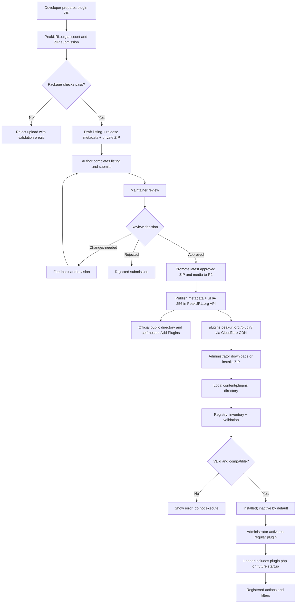
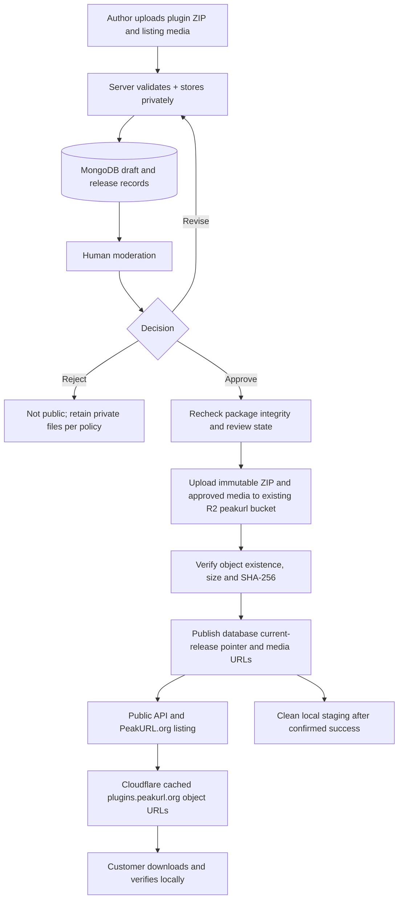
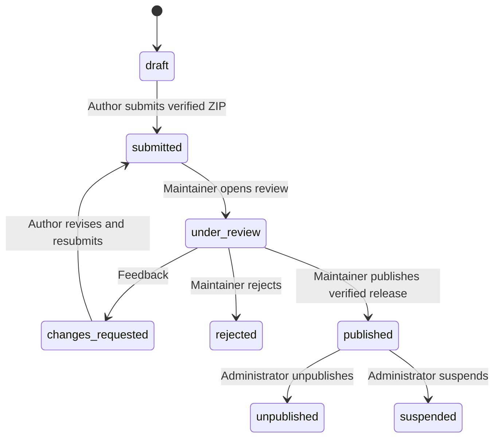
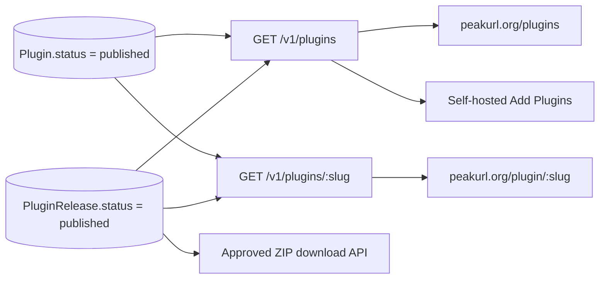
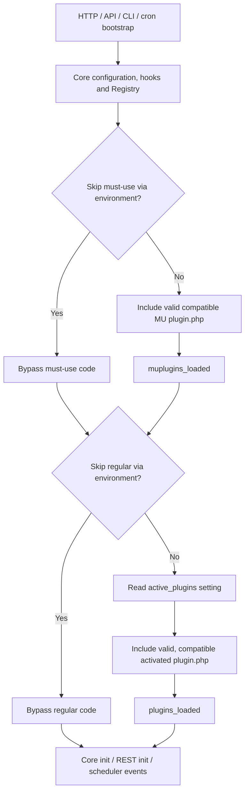
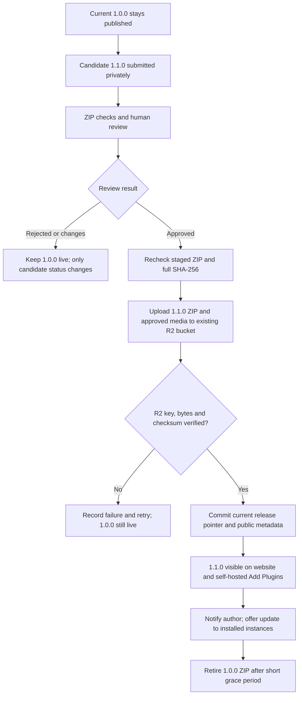

# PeakURL Plugin Ecosystem

## Architecture, Submission, Moderation, Distribution, Installation & Runtime Reference

**Reference date:** October 29, 2026  
**Target application release:** PeakURL 1.8.0  
**Repositories:** [`PeakURL/PeakURL`](https://github.com/PeakURL/PeakURL) (PHP application) and [`PeakURL/PeakURL.org`](https://github.com/PeakURL/PeakURL.org) (website, developer portal and directory backend)  
**Manifest contract:** [`https://peakurl.org/schemas/v1/plugin.json`](https://peakurl.org/schemas/v1/plugin.json) — JSON Schema Draft 2020-12  
**Document purpose:** An operational and engineering reference for maintainers, plugin developers, and self-hosted administrators.  
**Reference revision:** 1.4 — Current core implementation status verified against `PeakURL/PeakURL@dd71c3b8`; official developer package layout and a proposed WordPress-inspired PHP-header contract; staged remaining core-foundation plan. Existing v1 JSON schema remains unchanged until a separate, cross-repository implementation is reviewed.
**Latest architectural decision:** Use the existing `peakurl` R2 bucket, `plugin/` prefix and `plugins.peakurl.org`. Keep a single current approved ZIP per plugin after a short superseded-version grace period. Preserve historical metadata in MongoDB; each author may maintain source/history in their own GitHub repository, but GitHub is **not** a PeakURL-managed registry, installer source, or alternate distribution service.
**Architecture decision:** Existing Cloudflare R2 bucket `peakurl`; singular `plugin/` prefix; public delivery host `plugins.peakurl.org`; versioned immutable `{slug}-{version}.zip` keys; independent release moderation and a single current approved ZIP after a short grace period; **no central GitHub plugin registry**. These are **agreed design decisions, not claims that the R2 migration or update workflow is deployed**.
**Observed cache verification:** Two successive GET requests to `releases.peakurl.org/package/peakurl-1.7.2.zip` returned `MISS` and then `HIT`, October 29, 2026.

> **Implementation snapshot (October 29, 2026):** In the PHP core, Registry, Validator, `Loader`, activation/deactivation, regular-plugin deletion, secure local ZIP installation, dynamic server upload limits, and the Installed/Add Plugins UI are present in published `main` commits through [`dd71c3b8`](https://github.com/PeakURL/PeakURL/commit/dd71c3b86aecad89fc2dec9c65b873e3e83cdcdd). The latest frontend commit also adds conditional Must-Use tabs and a drag-and-drop file chooser. **Plugin-registered admin pages/settings, browser asset serving, supported UI extension points and in-place ZIP upgrades are not established as complete**; an agent is working on those next foundation stages and its report is awaited. The PeakURL.org approval-time R2 promotion and independently moderated release-update workflow are separately **planned**, not deployed. Any proposed metadata/header changes in this revision are decisions for later implementation, not as-built API fields.

---

## 1. Executive summary

The plugin ecosystem has two distinct systems, with Cloudflare R2 as the agreed published-artifact store:

- **PeakURL.org — publisher and distributor.** Authors submit ZIP archives and listing media. The website API validates archives, stores ZIPs privately, records listing/release metadata, supports human review, and publishes approved releases through public directory and download endpoints. **The agreed next storage change is approval-time promotion of the current ZIP and approved images to Cloudflare R2; a published plugin's new-version reviews must be independent of the current live listing.** Its Next.js website renders the published catalog. It **does not run** submitted PHP.
- **PeakURL — self-hosted consumer and runtime.** Each installation reads local plugin packages in its persistent `content/` tree, checks manifests and host compatibility, shows installed plugin metadata, and loads permitted PHP entry points through its existing `Loader` and hooks system. Installing or activating a plugin on one server does not change other PeakURL servers.

**A directory listing is not an installed plugin; an installed plugin is not necessarily active; a release awaiting approval is not the public release; and a published ZIP is not a Git commit.** These distinctions are fundamental. **A new update can be in review while the existing published release stays live.**

### 1.1 Lifecycle at a glance



**Implementation status:** The local Registry, ZIP installation, activation and `Loader` flow is implemented on the current PHP core `main` branch; marketplace-origin verification, direct directory installation, the local version-upgrade path and browser asset extensions are pending. R2 approval-time publication remains future website work.

---

## 2. System boundaries and source of truth

| Concern          | PeakURL.org                                                                                                                                              | Self-hosted PeakURL                                                                                                                                              |
| ---------------- | -------------------------------------------------------------------------------------------------------------------------------------------------------- | ---------------------------------------------------------------------------------------------------------------------------------------------------------------- |
| Owner            | Project website/service administrators                                                                                                                   | Administrator of each PeakURL installation                                                                                                                       |
| Technology       | Next.js frontend, Express API, MongoDB/Mongoose, private staging filesystem storage; **approved R2 publication planned**                                 | PHP 8.3+, existing hooks API, local persistent `content/`, existing settings/auth infrastructure                                                                 |
| Plugin identity  | Directory `slug` assigned when draft is created; record IDs and release versions                                                                         | Directory name used as local installation ID; manifest supplies display name and version                                                                         |
| Manifest         | Official public `plugin.json` v1 contract; parsed from ZIP on upload                                                                                     | Same fields checked locally; **no live schema HTTP fetch required**                                                                                              |
| Description      | Submission `readme.txt` parsed for listing text, plus editable listing fields                                                                            | Local Registry reads a safe bounded summary from `README.md`; optional manifest `description` is future schema work                                              |
| Metadata records | `Plugin`, `PluginRelease`, `PluginModerationLog` in database                                                                                             | Local `Registry`/`Metadata` inventory and persisted `active_plugins`, plus per-request `loaded` state                                                            |
| ZIP files        | **Current:** private local packages; **target:** temporary local drafts and the current approved ZIP in the existing `peakurl` R2 bucket under `plugin/` | **Implemented:** secure administrator ZIP upload to persistent `content/plugins/<id>/`, inactive by default; **pending:** upgrades and official API/R2 downloads |
| Listing media    | **Current:** staged/public local media; **target:** staged locally, approved icons/covers/screenshots under `plugin/<slug>/` in R2                       | May display remote listing media in Add Plugins; optional local assets belong to installed package                                                               |
| Publishing       | Moderation decision                                                                                                                                      | Not applicable; local admin controls execution                                                                                                                   |
| PHP execution    | **Never** executes submitted plugin code                                                                                                                 | **Implemented:** `Loader` includes validated, compatible must-use and activated regular `plugin.php` entry points under the host PHP process                     |

### 2.1 What “available in the repository” means

The phrase can refer to three different places:

1. **PeakURL.org plugin directory:** `https://peakurl.org/plugins` — the public website view of approved plugin records.
2. **PeakURL.org backend registry:** `https://api.peakurl.org/v1/plugins` — the API supplies published records from MongoDB and published releases from `PluginRelease`.
3. **GitHub source repositories:** `PeakURL/PeakURL.org` and `PeakURL/PeakURL` contain platform source code; an individual developer may optionally maintain their own plugin source repository, tags and historical releases there. GitHub is **not** an approved binary distribution authority.

**Publishing does not automatically create or merge a PR, write the ZIP into any GitHub repository, or copy code into any self-hosted server. There will be no central `PeakURL/plugins` GitHub registry or GitHub Actions synchronization layer.** PeakURL.org's MongoDB records and approved R2 objects are the only official distribution channel. A developer's optional GitHub URL provides source code and history, not a reviewed download replacement.

---

## 3. Package format and contract

### 3.1 Official recommended author package (new foundation decision)

Use this as the **official PeakURL plugin-development convention**, aligned with PeakURL's own PHP/React split. Only `plugin.json` and `plugin.php` are **mandatory**; all directories and supplemental files are optional. A PHP-only plugin need not contain any `server/`, `client/` or `assets/` directory.

```text
example-plugin.zip
└── example-plugin/
    ├── plugin.json                   # REQUIRED: authoritative metadata and compatibility
    ├── plugin.php                    # REQUIRED: PHP boot entry point; optional header comment
    ├── server/                       # Optional plugin PHP classes and server logic
    │   └── services/
    │       └── social-metadata.php   # Lowercase filename follows PeakURL core style
    ├── client/                       # Optional browser JavaScript/TypeScript source for authors
    │   ├── main.ts
    │   └── styles.css
    ├── assets/                       # Optional compiled, distributable browser assets
    │   ├── admin.js
    │   └── admin.css
    ├── README.md                     # Recommended local description/documentation
    ├── readme.txt                    # Recommended directory-submission metadata
    └── LICENSE                       # Recommended license text
```

**Official convention, not a hard-coded installer constraint:** `server/` for PHP; `client/` for development-time JavaScript/TypeScript source; `assets/` for production-ready files. In particular, the loader **only** executes root-level `plugin.php` and does not scan `server/`, execute `client/`, or automatically enqueue `assets/`. `plugin.php` loads its own PHP classes explicitly or through a plugin-owned autoloader. The browser must load JS/CSS through the **future** scoped asset-registration contract, not by dropping files into a directory. No Node/npm/Vite runtime is required on a customer server; any compilation happens before packaging. A distribution ZIP may omit development-only `client/` source if the compiled `assets/` are present.

Both the reviewed website archive inspector and PHP installer support a root archive layout or one single enclosing package directory. `plugin.json` and `plugin.php` must be paired in the **same accepted root**. `content/plugins/<folder>/` is the local installed destination; `content/mu-plugins/<folder>/` is operator-managed and not installable via the ordinary dashboard.

See Sections **24–26** for the full recommended header contract, planned metadata/schema evolution, frontend extension rules and final core acceptance gates.

### 3.2 Canonical `plugin.json` example

```json
{
	"$schema": "https://peakurl.org/schemas/v1/plugin.json",
	"name": "Example Plugin",
	"version": "1.0.0",
	"requires": "1.8.0",
	"testedUpTo": "1.8.0",
	"php": "8.3",
	"license": "MIT",
	"licenseUri": "https://opensource.org/licenses/MIT",
	"homepage": "https://example.com/plugin",
	"documentation": "https://example.com/plugin/docs",
	"repository": "https://github.com/example/plugin",
	"support": "https://example.com/support",
	"issues": "https://github.com/example/plugin/issues"
}
```

**Required fields:** `name`, `version`, `requires`, `testedUpTo`, `php`, `license`.  
**Optional fields:** `$schema`, `licenseUri`, `homepage`, `documentation`, `repository`, `support`, `issues`.

The **currently published v1** manifest rejects extra root fields, including `description`, `author`, `slug`, `id`, `entry`, nested `links` and `homepageUrl`. **Do not put the proposed description/author fields into a real ZIP until both official schema implementations and validators are updated.** Section 25 proposes a controlled, optional-field expansion before release. The website still owns verified publisher identity, directory slug and listing review metadata independently of author-entered text. `plugin.php` remains the fixed PHP entry point.

### 3.3 Version meanings

- **Schema version `v1`:** The shape of the manifest, not the plugin's release version.
- **`version`:** Version of this plugin ZIP, following SemVer 2.0.0.
- **`requires`:** Minimum compatible PeakURL core version.
- **`testedUpTo`:** Highest PeakURL core version verified by the publisher; must not precede `requires`.
- **`php`:** Minimum supported PHP runtime version.

A newer host than `testedUpTo` should generate an advisory compatibility warning rather than automatically disabling an otherwise valid plugin. A host below `requires` or `php` should be classified incompatible.

### 3.4 README conventions—important current mismatch

The website ZIP inspector currently parses **`readme.txt`** for structured directory information; the PHP Registry reports a local **`README.md`** first-paragraph description. They are separate paths, not a single canonical parser. A package containing both files satisfies both workflows today. Before standardizing on a single filename/parser, update both codebases and the developer documentation together; do not silently assume the two parsers are interchangeable.

---

## 4. Developer submission on PeakURL.org

### 4.1 The actual author journey

1. Author opens **[`/account/plugins/new`](https://peakurl.org/account/plugins/new)** on PeakURL.org.
2. They authenticate, and the backend requires a **verified email address** for draft creation, package upload and submission.
3. The new-submission page accepts a `.zip` archive, performs a browser-side 25 MB size check, and sends the archive as base64 in a request to the developer API. Server-side inspection remains authoritative.
4. The API validates the archive and creates both a `Plugin` directory listing record and a `PluginRelease` record in **draft** status. The package is saved in private storage.
5. A unique, canonical URL slug is derived from the manifest display name. The author cannot subsequently change that slug; an administrative pre-publication override is separately supported and logged.
6. The author is redirected to **`/account/plugins/<id>`** to review or update listing data, upload listing media and submit for moderation.
7. The author selects **Submit for Review**; the backend requires a verified release ZIP with a validated manifest and SHA-256 checksum.
8. The listing and selected release move to **submitted**. The action is audited, and best-effort notifications are dispatched to the author and administrators.

### 4.2 Website API endpoints

All routes below are implemented under the API's `/v1` prefix; the authenticated developer API is separate from the public catalog.

| Method   | API route                                             | Purpose                                                 |
| -------- | ----------------------------------------------------- | ------------------------------------------------------- |
| `GET`    | `/v1/developer/plugins`                               | List an author's submissions                            |
| `POST`   | `/v1/developer/plugins`                               | Create a draft; the current web form sends the ZIP here |
| `GET`    | `/v1/developer/plugins/:id`                           | Show listing, releases, review history                  |
| `PATCH`  | `/v1/developer/plugins/:id`                           | Edit permitted draft/revision listing fields            |
| `POST`   | `/v1/developer/plugins/:id/package`                   | Upload a release ZIP                                    |
| `POST`   | `/v1/developer/plugins/:id/releases/:version/package` | Upload package for a specified release version          |
| `POST`   | `/v1/developer/plugins/:id/releases`                  | Create a new release draft                              |
| `POST`   | `/v1/developer/plugins/:id/media`                     | Upload icon, cover or screenshots                       |
| `DELETE` | `/v1/developer/plugins/:id/media/:assetType`          | Remove staged listing media                             |
| `POST`   | `/v1/developer/plugins/:id/submit`                    | Submit draft/revision for review                        |

Developer API routes require authentication; draft creation, package upload and review submission additionally enforce email verification. Existing controllers check ownership against `author.userId` for the relevant operations.

---

## 5. What PeakURL.org checks during upload

**The upload check is a package-format and archive-safety gate, not a proof that arbitrary PHP is safe to execute.** Human moderation remains necessary.

### 5.1 Server-side archive gates in reviewed source

| Check                  | Reviewed website behavior                                                                                               |
| ---------------------- | ----------------------------------------------------------------------------------------------------------------------- |
| Input                  | Nonempty ZIP buffer; route accepts raw ZIP or JSON `packageBase64`                                                      |
| Compressed ZIP size    | Inspector defaults to **25 MiB**; the raw upload route has a **30 MB** parsing limit                                    |
| Uncompressed total     | Maximum **100 MiB**                                                                                                     |
| Entry count            | Maximum **5,000** ZIP entries                                                                                           |
| Compression ratio      | Maximum **100:1** per entry                                                                                             |
| ZIP structure          | Requires ZIP End of Central Directory and checks central-directory boundaries                                           |
| Path safety            | Rejects `..` traversal segments, absolute paths, Windows drive paths/backslashes, control characters and POSIX symlinks |
| `plugin.json` location | Root or within one top-level directory                                                                                  |
| Manifest size          | Maximum **512 KiB** for ZIP submission processing                                                                       |
| Entry point            | Exact `plugin.php` beside `plugin.json`                                                                                 |
| Supported compression  | ZIP `STORE` or `DEFLATE` for entries being extracted by the inspector                                                   |
| Manifest shape         | Valid object; six required fields; only allowed v1 fields; strict string, URL and SemVer checks                         |
| Release identity       | Package name/slug association and expected release version checked for uploads to existing listing                      |
| `testedUpTo`           | Must be at or above `requires` using SemVer precedence                                                                  |
| Metadata extraction    | Parses optional `readme.txt` into directory summary/details                                                             |
| Integrity              | Computes and records **SHA-256** of the uploaded ZIP                                                                    |

These are the **current website submission inspector defaults**. They are not a substitute for revalidating ZIPs when a self-hosted administrator installs a package. The local PHP installer must enforce its own extraction bounds, path containment, collisions and cleanup.

### 5.2 What happens on validation failure

The API refuses the invalid upload and returns an error rather than publishing the package. A ZIP that passes these gates proceeds only into a **draft** or another permitted pre-publication status; it is **not automatically approved**.

### 5.3 Listing media is a separate submission path

The author can upload icon/cover/screenshot media. The website processes images using its media workflow and keeps them under a staging directory until moderation approval; media then moves into public-serving storage. ZIP binaries are not treated as public static website assets.

---

## 6. Storage, database records and audit trail

### 6.1 One R2 bucket, one new prefix — agreed target

**Use the existing Cloudflare R2 bucket `peakurl`. Do not create a second plugin bucket.** The real bucket currently has `assets/`, `geoip/`, `package/`, `health.txt` and `latest.zip`. Add the singular `plugin/` prefix. The public distribution hostname is plural: **`plugins.peakurl.org`**.

```text
R2 bucket: peakurl
├── assets/                            # Existing; unchanged
├── geoip/                             # Existing; unchanged
├── package/                           # Existing versioned core releases
├── plugin/                            # NEW: published plugin artifacts only
│   ├── example-plugin-1.0.0.zip        # One approved current version per slug
│   ├── example-plugin/                 # Media grouped under the plugin's slug
│   │   ├── icon-128.webp
│   │   ├── icon-256.webp
│   │   ├── cover.webp
│   │   └── screenshots/
│   │       └── overview.webp
│   └── another-plugin/
│       └── icon-256.webp
├── health.txt                         # Existing; unchanged
└── latest.zip                         # Existing mutable core release alias
```

**Object key ↔ URL mapping** (same key after hostname; Cloudflare does not automatically mount a bucket subdirectory):

| R2 object key                                     | Intended external URL                                                         |
| ------------------------------------------------- | ----------------------------------------------------------------------------- |
| `plugin/example-plugin-1.0.0.zip`                 | `https://plugins.peakurl.org/plugin/example-plugin-1.0.0.zip`                 |
| `plugin/example-plugin/icon-256.webp`             | `https://plugins.peakurl.org/plugin/example-plugin/icon-256.webp`             |
| `plugin/example-plugin/cover.webp`                | `https://plugins.peakurl.org/plugin/example-plugin/cover.webp`                |
| `plugin/example-plugin/screenshots/overview.webp` | `https://plugins.peakurl.org/plugin/example-plugin/screenshots/overview.webp` |

**Why no checksum in the ZIP filename?** The `{slug}-{version}.zip` convention is readable and cache-friendly if each version is **immutable**. Store the **full 64-character SHA-256** in MongoDB and the published API, and verify the downloaded bytes before local installation. An object ETag is _not_ a substitute for that SHA-256. Replacing bytes under a published version is forbidden; release different bytes as a new version. Package file names and media names are intentionally independent of the database's internal plugin ID.

**Why keep media within the plugin prefix?** It groups each plugin's public images without another top-level media namespace. Published ZIP files remain at `plugin/{slug}-{version}.zip`, as agreed. Images may use stable names; changing a stable image means purging that URL from Cloudflare, whereas versioned/hashed image names can use very long TTLs without purges.

### 6.2 Before approval: private local staging (current implementation)

The **currently reviewed** website code writes verified ZIP packages to:

```text
<website runtime working directory>/storage/plugins/packages/
```

Override via `PLUGIN_PACKAGE_STORAGE_DIR`. It writes internal filenames derived from plugin ID, version and timestamp; the user-facing filename is `<slug>-<version>.zip`. Both approved and unapproved ZIPs currently live in this private directory; the existing controller streams an approved ZIP through the API.

Listing media currently uses:

```text
<website runtime working directory>/storage/plugins/media/
  staging/<plugin-id>/
  public/<plugin-slug>/
```

Override via `PLUGIN_MEDIA_STORAGE_PATH`. **Target change:** retain private `staging/` only; upload approved media to R2 `plugin/<slug>/` instead of permanent local `public/` storage. Keep private staging on a persistent volume (or similarly durable storage), because pending author reviews must survive container restarts and deployments. Never put pending/rejected ZIPs or unapproved media in the publicly reachable R2 bucket.

**Retention policy — proposed:** clean abandoned and rejected staging files after a documented grace period (for example 30 days, with notification/audit safeguards); keep packages pending review and packages awaiting publication retries until resolved. Never delete the only recoverable copy of an approved version before R2 publication is verified.

### 6.3 Database is the authority for status, version and checksums

| Model                 | Responsibility                                                                                                                                |
| --------------------- | --------------------------------------------------------------------------------------------------------------------------------------------- |
| `Plugin`              | Directory slug, display name, summary, publisher, tags, current version, links, media URLs, status and featured/trust details                 |
| `PluginRelease`       | Exact release version, manifest/readme snapshot, review status, **full package SHA-256**, size, file key/path, timestamps and review metadata |
| `PluginModerationLog` | Review actor, actions, requested changes, reasons, approval/withdrawal audit                                                                  |

**Current schema:** `PluginRelease.package.storagePath` is a private local absolute path hidden from public queries. **Target schema change:** introduce a clearly named R2 object key / storage provider reference for approved artifacts; preserve explicit temporary local-path handling only while staged. Avoid exposing local disk paths, R2 credentials, or storage internals in public responses. The current `formatPublicPluginListing()` already exposes `version` and a `distribution` object containing relative `downloadUrl`, `sha256`, `packageSizeBytes` and `isVerifiedPackage`. **Preserve and adapt that contract**, moving media URLs to the approved R2 host when promoted. The download path stays stable even when its underlying storage backend changes.

Keep audit/history records for previous versions in MongoDB, even if older ZIP binary objects are pruned. **Release reviews are independent from the already-published parent listing; pending candidates must not change `Plugin.currentVersion` or public description, requirements, download metadata or media URLs.** A developer's optional `repository` URL is a source reference, not an automatically verified binary backup.

### 6.4 The proposed approval-to-R2 transaction



**This R2 promotion is a target architecture, not the current website publish implementation.** For updates, the parent listing **stays published** and the current approved ZIP remains live throughout candidate review. A successful R2 upload is not enough to change the public version; only approval of that specific `PluginRelease` and a successful publication switch may do so. Full update policy: Section 13. The existing `approveAndPublish()` currently checks stored local artifacts, marks records `published`, and copies media into its local public directory; it does **not** yet upload packages/media to R2. Updating that function and the storage utility is required.

For the target flow, use failure-safe ordering: validate → upload immutable objects → verify remote content → update database status/pointers → clean up local staging. Preserve the old published release until the new one is safely published. Make retry idempotent: retries should not create conflicting objects or publish half-finished releases. If database publication fails after R2 upload, keep the older published pointer unchanged and reconcile/delete the newly orphaned R2 objects through a safe cleanup process.

### 6.5 Where the approved files are loaded and executed

**Under the agreed R2 design, on the PeakURL.org backend:** Approved ZIP and image bytes are **stored** in R2 and **served** through public R2/CDN URLs; nothing executes `plugin.php`. The marketing website renders plugin cards using the public API and approved images. Approval does **not** modify the PeakURL.org GitHub repository and does not install code into anyone's PHP server.

**On a self-hosted PeakURL instance:** An administrator obtains the approved ZIP, verifies its SHA-256 and manifest, and installs it into the persistent `content/plugins/<slug>/`. Only its local PHP `Loader` can include `plugin.php` according to actual activation state, after runtime implementation and verification. Must-use plugins are a separate deployment-managed `content/mu-plugins/` mechanism and should not be installed by the normal public ZIP flow.

### 6.6 Multi-hostname exposure and public access

**Cloudflare R2 custom domains expose the bucket, not a chosen prefix.** Connecting `plugins.peakurl.org` to `peakurl` does not automatically hide `latest.zip`, `geoip/`, `assets/` or `package/` on the new domain. Scope a WAF custom rule to the plugin hostname:

```text
(http.host eq "plugins.peakurl.org" and not starts_with(http.request.uri.path, "/plugin/"))
Action: Block
```

This limits the _new hostname_ to `plugin/` paths; it does not make files under other publicly reachable domains private. Review existing `releases.peakurl.org` and `static.peakurl.org` rules as well if plugin objects should not be reachable through those hostnames. **Never store secrets, pending submissions or sensitive files in a bucket with public custom domains.** Disable the public `r2.dev` endpoint if enabled so the custom-domain WAF cannot be bypassed. Test effective path normalization and encoded-path handling before relying on hostname restrictions. Cache and WAF are delivery/hostname controls; they are not a substitute for private staging.

Cloudflare reference: https://developers.cloudflare.com/r2/buckets/public-buckets/ and https://developers.cloudflare.com/cache/interaction-cloudflare-products/waf-snippets/.

---

## 7. Moderation and publication

### 7.1 Review stages



This diagram presents the **intended common journey**, not a complete formal restriction of every controller transition. The Mongoose models also enumerate `approved` and, for releases, `superseded`. The reviewed admin `approveAndPublish` controller publishes directly rather than requiring a separate observable `approved` step.

### 7.2 Admin API and review actions

The website's admin plugin routes require **superadmin authorization**.

| Action                      | Endpoint (under `/v1/admin/plugins`) | Outcome                                                                           |
| --------------------------- | ------------------------------------ | --------------------------------------------------------------------------------- |
| List/review                 | `GET /`, `GET /:id`                  | Review listing, releases and moderation history                                   |
| Begin review                | `POST /:id/open-review`              | Changes submitted listing to `under_review`                                       |
| Request changes             | `POST /:id/request-changes`          | Records feedback, updates status and notifies author                              |
| Reject                      | `POST /:id/reject`                   | Records reason, marks rejected and notifies author                                |
| Publish                     | `POST /:id/publish`                  | Checks verified release and stored file, publishes plugin/release, promotes media |
| Approve media               | `POST /:id/approve-media`            | Promotes reviewed listing-media updates                                           |
| Change pre-publication slug | `POST /:id/slug`                     | Controlled/admin-audited slug override                                            |
| Unpublish/suspend           | `POST /:id/unpublish`                | Changes listing status so public queries no longer expose it                      |
| Update trust                | `PATCH /:id/trust`                   | Adjusts official/featured-related directory metadata                              |

### 7.3 What happens when a maintainer approves — present and proposed

1. The API finds the selected release and verifies it has `manifestValid`, a stored SHA-256 and a private package file that still exists.
2. The `Plugin` listing is marked `published`, and current release/compatibility metadata is updated.
3. Pending media is promoted into publicly served media storage.
4. The `PluginRelease` is marked `published`, with reviewer and timestamp.
5. An audit log is written.
6. The author is notified on a best-effort basis.
7. The public directory and download handlers can now find this listing/release.

**Target change for the R2 transition:** Between checks and database publication, upload the verified archive to the immutable R2 key and approved images to `plugin/<slug>/`, then verify that every required object is present. Only then change public status and URLs. Keep staging recoverable on failure. When a newer release is approved, update the current pointer only after successful promotion, then remove the older approved ZIP after an explicit grace period. Keep historical database and moderation records.

**Important:** The reviewed publish handler relies on a previously verified package flag and file presence; it does not visibly rerun every ZIP security inspection at approval time. A production review should therefore protect artifact immutability, checksum correspondence and operational access to private storage.

### 7.4 Subsequent releases use a separate moderation lifecycle (target)

A published plugin listing must **remain published** while its author submits a new version. The current website controller does not yet meet this: `uploadReleasePackage()` and `submitForReview()` restrict parent listing statuses; upload mutates `Plugin.currentVersion`; and `approveAndPublish()` selects the newest release by creation time. Implement explicit release-targeted author and administrator routes that change the candidate `PluginRelease` only, leaving parent listing metadata unchanged until successful approval. The full state table, sequencing, R2 publication and tests are in Section 13.

**Approval of a new release is not approval of a new plugin identity.** The slug/author ownership remain stable, review the exact candidate ZIP, and persist per-release notes and timestamps. Rejection must never remove a currently published listing from `/v1/plugins`.

---

## 8. How a published plugin appears on PeakURL.org

The publication path is database-driven:



### 8.1 Public API endpoints

| Public endpoint                                    | Purpose                                                                                        |
| -------------------------------------------------- | ---------------------------------------------------------------------------------------------- |
| `GET https://api.peakurl.org/v1/plugins`           | Paginated published listings; supports search `q`, tags `tag`, sorting `sort`, `page`, `limit` |
| `GET /v1/plugins/:slug`                            | Details of one published plugin                                                                |
| `GET /v1/plugins/:slug/releases`                   | Published release history                                                                      |
| `GET /v1/plugins/:slug/releases/:version`          | Metadata for a specific published version                                                      |
| `GET /v1/plugins/:slug/download`                   | ZIP of latest published release                                                                |
| `GET /v1/plugins/:slug/releases/:version/download` | ZIP of specified published release                                                             |
| `GET /v1/plugins/:slug/media/:filename`            | Approved listing media                                                                         |

The listing controller filters `Plugin.status === 'published'` and joins **published** release metadata. The **current** download handler also requires both a published listing and a published release, checks the private local ZIP storage file and streams it with `application/zip`, `Content-Disposition`, and checksum-derived ETag. The **target** will preserve these API routes, authorize the published release, and redirect to the immutable `plugins.peakurl.org/plugin/<slug>-<version>.zip` object (or otherwise provide the approved object URL). The PHP installer must verify the ZIP against the published full SHA-256.

The marketing Next.js directory calls this API (`fetchPublishedPlugins()` in `site/src/lib/data/pluginDirectory.ts`), displays published records, and links to published details. Its current fetch function requests up to 100 records; server-side pagination exists, but listing **every** plugin on the marketing site beyond 100 would require verifying or extending the frontend pagination behavior.

### 8.2 Upcoming concepts are not published releases

PeakURL.org may also show **planned/upcoming plugin concepts** from static website content. They are editorial previews, not downloadable releases and should never be returned as available installations by the self-hosted Add Plugins browser. The self-hosted browser is intended to consume only the public **published-plugin API**.

### 8.3 Visibility and timing

An approved record is eligible to appear as soon as the database and its API response are updated. **After the R2 change, database publication must follow successful object promotion**, not precede it. Real visibility can depend on frontend caching, API reachability and propagation. Publication itself does **not** trigger a GitHub source commit or deployment of each plugin into the marketing site's codebase.

---

## 9. How plugins appear in the self-hosted PeakURL dashboard

### 9.1 The two inventory sources

- **Installed / Must-Use view:** The local PHP `Registry` reads the installation's filesystem through `GET /api/v1/system/plugins`. This includes manually copied and administrator-uploaded ZIP packages. It **does not** use the public marketplace catalog.
- **Add Plugins view:** The React dashboard reads `https://api.peakurl.org/v1/plugins` via RTK Query, showing public published listings, search, sorting, pagination and detail links. The reviewed P4-B correction removed a redundant PHP proxy after live browser CORS verification.

### 9.2 Installed versus published versus active

| State                    | Meaning                                                                                                                              | Shown where?                                            |
| ------------------------ | ------------------------------------------------------------------------------------------------------------------------------------ | ------------------------------------------------------- |
| Draft                    | ZIP/metadata saved privately for author                                                                                              | Author portal only                                      |
| Submitted / under review | Awaiting maintainer approval                                                                                                         | Author and moderation portals                           |
| Published                | Approved public directory record/release                                                                                             | PeakURL.org website and self-hosted Add Plugins browser |
| Downloaded               | ZIP retrieved by a user/admin                                                                                                        | Download destination; **not installed yet**             |
| Installed                | Files placed under `content/plugins/<id>/`                                                                                           | Local Installed view                                    |
| Inactive regular plugin  | Files present, but regular plugin not enabled                                                                                        | Local Installed view once activation state exists       |
| Active regular plugin    | Listed in persisted `active_plugins`; `Loader` selects it on subsequent startup if valid/compatible and not bypassed                 | Local Installed view                                    |
| Must-use                 | Installed under `content/mu-plugins/<id>/`; `Loader` loads it automatically when valid/compatible unless emergency bypass is enabled | Local Must-Use view when such plugins exist             |
| Invalid / incompatible   | Manifest, entry point or host version fails                                                                                          | Local diagnostics; must **not** execute                 |

This prevents misleading labels. **A Compatible status only means that checked metadata satisfies the declared requirements; it does not prove the plugin has been executed or that its behavior is safe.**

### 9.3 Local filesystem

```text
<effective PEAKURL_CONTENT_DIR or resolved content path>/
├── plugins/
│   └── example-plugin/
│       ├── plugin.json
│       ├── plugin.php
│       └── README.md
└── mu-plugins/
    └── system-integration/
        ├── plugin.json
        ├── plugin.php
        └── README.md
```

The updater already has content preservation coverage, including `content/plugins/` and `content/mu-plugins/`. The location is derived from PeakURL's effective content configuration and must work in both development and packaged production layouts.

---

## 10. Local Registry, validation and compatibility (implemented)

The PHP core `main` branch implements these components under `server/core/plugins/`:

| Component   | File            | Responsibility                                                                                 |
| ----------- | --------------- | ---------------------------------------------------------------------------------------------- |
| `Registry`  | `registry.php`  | Enumerate local regular and must-use directories, identify installed packages, return metadata |
| `Validator` | `validator.php` | Validate the local canonical manifest and host compatibility                                   |
| `Metadata`  | `metadata.php`  | Structured immutable-style representation, diagnostics, sanitized API serialization            |
| `Type`      | `type.php`      | `regular` versus `must_use` categorization                                                     |

The reported registry checks immediate child directories, bounds local manifest reads to 64 KiB, verifies local `plugin.php` without executing it, rejects filesystem escapes/symlinks, reports identifier collisions, and separates **validity** from **compatibility**. The inventory route requires the existing administrative capability policy (`manage_updates` or `manage_site_settings`).

Discovery alone does **not** execute plugin PHP; only the separate `Loader` does. The core now also implements activation and ZIP installation as distinct, authorized operations; those do not execute plugin PHP during mere inventory reads or ZIP extraction.

---

## 11. Installing a plugin into PeakURL (implemented for new local packages; upgrade pending)

There are currently two ways for a self-hosted administrator to get a local regular-plugin package into `content/plugins/<id>/`: deploy a correctly structured directory or use **Add New Plugin → Upload Plugin**. A listing on PeakURL.org's public directory does not automatically install a package; direct official-directory installation remains P4-G.

### 11.1 Manual installation

A self-hosted administrator places a trusted folder under the effective `content/plugins/<id>/`. The Registry discovers the metadata. **Copying files does not activate a regular plugin.** Must-use directories are deployed and controlled separately by the server operator.

### 11.2 Administrator ZIP installation — current core behavior

`POST /api/v1/system/plugins/upload` is implemented with the existing admin capability checks. It validates uploaded ZIP archives, enforces archive entry/decompression/compression-ratio/path/symlink constraints, pairs `plugin.json` with root-level `plugin.php`, stages installation on the same filesystem and verifies installed metadata without executing plugin PHP. It refuses collisions and leaves new regular plugins **inactive**. The current internal archive constraints include 5,000 entries, 100 MB total uncompressed bytes and a 100:1 ratio; the upload file-size limit is dynamically computed from effective PHP configuration (`upload_max_filesize`, `post_max_size`) and applicable application constraints. UI shows the effective server-provided limit. Website **submission** constraints can differ and should be aligned when marketplace installation is implemented.

The installer is **not** an in-place version upgrader. It deliberately rejects already-installed IDs; P4-F must add a separate safe replacement transaction with rollback and preservation of activation state and plugin data.

### 11.3 Security boundaries

No installation, admin list view, manifest validation or archive inspection should execute `plugin.php`. ZIP package PHP executes only on later permitted runtime startup. Must-use plugins must never be installed, updated or deleted through normal public directory actions. Browser assets in `assets/` are not automatically published as public files by the current installer; that requires the still-planned frontend asset contract.

---

## 12. Runtime loading, hook registration and recovery (implemented core foundation)

### 12.1 Actual loader sequence

`server/core/plugins/loader.php` (`PeakURL\Core\Plugins\Loader`) is included early in the public redirect, API and cron/application entry points. The source explicitly loads compatible and valid must-use packages **first**, fires `muplugins_loaded`, obtains persisted regular-plugin activation IDs, loads compatible enabled regular packages and fires `plugins_loaded`. Core dispatches `init`, `rest_api_init` and `register_jobs` afterward where applicable.



### 12.2 Activation and loaded status

- `active` is **persisted intent** in `active_plugins`, atomically modified under existing database row locking. `loaded` reflects execution on a particular PHP request; they can differ.
- A regular plugin only runs after an authorized activation and on subsequent relevant startup. Deactivation does not undo PHP already executed on the current request.
- Valid must-use plugins load without a database activation toggle. They are operated through deployments, not the dashboard mutation API.
- Invalid or incompatible packages are not executed; a valid manifest does not prove the plugin's code is safe.

### 12.3 Server PHP hooks

The entry point registers callbacks through PeakURL's existing `add_action()`, `add_filter()`, `do_action()` and `apply_filters()` helpers. A plugin can load its optional `server/` classes using `require_once` or its own autoloader. For example, registration with `add_filter( 'link_social_metadata', $callback, 10, 2 )` occurs at startup; its callback runs when that filter fires in the link-preview path. No second hook system is required.

### 12.4 Safe-mode recovery

`PEAKURL_SKIP_PLUGINS=1` skips regular plugins and `PEAKURL_SKIP_MU_PLUGINS=1` skips must-use plugins **before** their PHP entry points run. Settings read failures are recorded for diagnosis. Operators should use these environment settings to recover from a faulty plugin, then disable or remove the affected extension through authorized management processes.

### 12.5 Pending admin UI and browser assets

**Not yet a supported core contract:** activation does not automatically register a sidebar page, render React UI, enqueue JavaScript/CSS or expose arbitrary files from `assets/`. These requirements belong to the separately in-progress P4-E foundation. See Sections 24–26 for the proposed contract and safeguards.

---

## 13. Release updates, independent moderation, latest-only binaries and GitHub boundaries

> **Architecture decision, not a completed implementation:** Release-specific update moderation and approval-time R2 promotion are the accepted target. The reviewed PeakURL.org `main` branch still lacks correct review isolation for updates to already published plugins; see Sections 18 and 22. Do not enable automated updates against that incomplete flow.

### 13.1 Four independent concepts

| Concept                | Authority                                                     | Important rule                                                                              |
| ---------------------- | ------------------------------------------------------------- | ------------------------------------------------------------------------------------------- |
| Public plugin listing  | `Plugin` record in PeakURL.org MongoDB                        | Remains **published** while a new release is pending, rejected or needs changes             |
| Release under review   | A particular `PluginRelease` record                           | Has its **own** lifecycle; cannot change public `currentVersion` during draft/upload/review |
| Current approved ZIP   | Immutable R2 object selected by the published release pointer | A versioned URL refers to **one specific checksum**; no overwrites                          |
| Local installed plugin | Each self-hosted PeakURL server                               | Remains at installed version until its administrator accepts/installs an update             |

Do not conflate GitHub tags, parent listing status, release review status, R2 retention, and local activation state. A plugin can simultaneously have `1.0.0` live, `1.1.0` awaiting moderation, and `0.9.0` visible as an historical metadata record.

### 13.2 Release-state model: a pending update must not take down a published plugin

| Parent `Plugin.status` | Current approved release | Candidate `PluginRelease.status`       | Public-facing version |
| ---------------------- | ------------------------ | -------------------------------------- | --------------------- |
| `published`            | `1.0.0` — `published`    | `1.1.0` — `draft`                      | `1.0.0`               |
| `published`            | `1.0.0` — `published`    | `1.1.0` — `submitted` / `under_review` | `1.0.0`               |
| `published`            | `1.0.0` — `published`    | `1.1.0` — `changes_requested`          | `1.0.0`               |
| `published`            | `1.0.0` — `published`    | `1.1.0` — `rejected`                   | `1.0.0`               |
| `published`            | `1.1.0` — `published`    | `1.0.0` — `superseded`                 | `1.1.0`               |

**Existing schema fit:** `PluginRelease` already defines `draft`, `submitted`, `under_review`, `changes_requested`, `rejected`, `approved`, `published`, and `superseded`. Reuse it; avoid a new release subsystem or a second registry. The first approval of a new plugin can set both parent and release to published; **subsequent release reviews must only alter the candidate release** until successful publication.

**Selection is explicit:** Every upload, submission, review note, request for changes, rejection and publish action should target a specific release ID or exact `(pluginId, version)`. Never infer the intended release using only `findOne(...).sort({createdAt:-1})`. Enforce author ownership and publisher-only moderation on the server, with an auditable transition log. Concurrent approvals must not switch the current release incorrectly.

### 13.3 Complete author-to-review workflow for an update

1. Developer opens their already published plugin in the PeakURL.org account area and chooses **Submit New Version**; the existing public listing remains published.
2. Developer declares the next **SemVer** (e.g., `1.1.0`), creates a candidate release, and uploads a ZIP containing the canonical `plugin.json`, `plugin.php` and optional `readme.txt` plus source files.
3. PeakURL.org checks that the manifest identity belongs to that plugin, the manifest `version` equals the candidate version, and the version has not already been published with a different binary. Existing ZIP safety gates, size limits, SemVer and minimum PHP requirements apply equally to updates.
4. The **candidate ZIP stays in persistent private local staging**, associated with that release ID; calculate and retain full SHA-256, size, and exact manifest/readme snapshot. Do **not** put it in public R2 during review.
5. Developer submits the candidate release. The release transitions to `submitted`, then a maintainer moves it into `under_review`; the parent listing remains `published` and `currentVersion` stays at `1.0.0`.
6. Maintainer reviews code changes and security behavior relative to the currently approved release, not just ZIP shape. Request changes or reject the **candidate only**; existing users retain a functioning public download.
7. On approval, validate the exact approved bytes and review decision once more, then move through the publication procedure in Section 13.4. Notify the author and record a release-specific moderation log.

**Media and listing changes:** Keep new icons, covers, screenshots and release descriptions staged during review. Publish only approved versions of those assets, and do not switch public listings to candidate metadata prematurely. Decide whether media-only updates may receive independent moderation without creating a binary release; the current website has an `approve-media` endpoint that should retain its separate purpose.

### 13.4 Approval-to-R2 publication — safe order and failure handling



Concrete example:

```text
Private staging (not publicly reachable):
  storage/plugins/packages/<release-internal-key>.zip

Existing R2 bucket: peakurl
  plugin/example-plugin-1.0.0.zip  # old public version during transition
  plugin/example-plugin-1.1.0.zip  # new immutable approved object
  plugin/example-plugin/icon-256.webp
  plugin/example-plugin/cover.webp

Public current-download API:
  https://api.peakurl.org/v1/plugins/example-plugin/download

Immutable direct CDN object:
  https://plugins.peakurl.org/plugin/example-plugin-1.1.0.zip
```

**Never modify a published R2 object for the same `{slug}-{version}.zip` key.** Keep full SHA-256 in the release database and public distribution metadata. If a new upload uses an already-released version, reject it unless it is the exact same bytes and a deliberate idempotent retry of the same publication. Corrected software must receive a new SemVer. Cloudflare ETag does not replace full SHA-256.

**Failure semantics:** A failed upload, checksum mismatch, CDN access failure, database transaction failure or optimistic-concurrency conflict must **not** change the current-release pointer. Keep private staging to retry. An approved but unreferenced object already uploaded to public R2 may briefly be accessible by its known URL; classify and reconcile such orphaned objects promptly. Never delete the old current ZIP before the new published API and actual downloaded bytes are verified. An R2 write and a MongoDB commit are not a single cross-service transaction; design idempotent operations and recovery accordingly.

### 13.5 What latest-only retention means in practice

**Target steady state:** One current approved ZIP per plugin in the `peakurl` R2 bucket. Keep the immediately superseded ZIP **temporarily** for a proposed 7–14-day recovery window, then delete it and purge its cached URL as needed. The precise duration is an operational setting/policy to finalize, not a currently implemented timer. Consider retaining a private trusted backup for emergency rollback; GitHub does not guarantee reproducible approved bytes.

- **Do retain:** Historical `PluginRelease` versions, manifests, checksums, moderation decisions, reviewer/approval timestamps and changelog in MongoDB.
- **Do not retain indefinitely in public R2:** Every historical ZIP, unless the project's policy explicitly changes.
- **Do not immediately delete:** The last approved ZIP while its replacement is still uploading, being reviewed, or in the grace period.
- **Do not advertise obsolete downloads:** After cleanup, a historical release page may show version metadata, but its download must clearly say no artifact is available. Define `410 Gone` or a grounded equivalent for the old version-specific download route; do not silently redirect an old-version request to the newest file.
- **If emergency rollback is required after cleanup:** Restore only a trusted copy that matches its recorded checksum, or require a newly reviewed release. An author-provided GitHub archive cannot automatically become an approved rollback.

A scheduled cleanup task may remove **only** confirmed superseded objects older than the grace threshold; it must recheck database current-release state before deletion, use the exact R2 key and log its work. No broad prefix deletion.

### 13.6 Caching and why we do not use a mutable `plugin.zip`

**Preferred:** `https://plugins.peakurl.org/plugin/example-plugin-1.1.0.zip` with an immutable long-lived cache policy. After approval of `1.2.0`, the API points to `example-plugin-1.2.0.zip`. There is normally **no need to purge the new or old ZIP simply to switch versions**; URLs do not overlap.

**Not preferred:** `plugin/example-plugin.zip`, `plugin/latest.zip`, or overwriting a fixed URL. Those designs need coordinated CDN/browser cache invalidation and can accidentally serve stale binaries. The stable **API endpoint** is the latest alias; the CDN object key is always versioned. On security withdrawal or old-file removal, delete/block the object and purge cached URLs, including access via any other configured public hostname. A published file copied to a client cannot be revoked retroactively.

Media stays under `plugin/<slug>/` as agreed (e.g., `icon-256.webp`, `cover.webp`, `screenshots/overview.webp`). Stable media names require targeted cache purges when replaced; optionally use versioned filenames in a future optimization. The current `releases.peakurl.org/package/peakurl-1.7.2.zip` GET test returned **MISS then HIT** with `Cache-Control: max-age=31536000`; it is a working example of caching eligible immutable files, **not** proof that every Cloudflare edge is warm or that mutable paths should receive that TTL.

### 13.7 Update detection on a self-hosted PeakURL server

1. Local `Registry` reads installed `plugin.json` and tracks the actual installed version and local activation state. Installation does not imply activation.
2. A future update check queries `https://api.peakurl.org/v1/plugins` or a plugin-specific **published-only** API response for the exact canonical plugin slug. The host should use bounded timeouts, caching and non-blocking failure behavior; it must never require an API connection during every local PHP request.
3. Compare strict SemVer, evaluate core/PHP compatibility, and show **Update available** only when the approved public version is newer and compatible or clearly communicate compatibility warnings. Never surface a candidate `draft`, `submitted` or `under_review` version as downloadable.
4. Administrator reviews the version/changelog and explicitly chooses Update (unless a separate future opt-in automatic-update policy is created and documented).
5. The installer obtains the official approved package URL from the API, downloads it over HTTPS, verifies full SHA-256 against the authoritative API record, validates `plugin.json` identity/version/compatibility and ZIP security rules again, and stages the replacement outside the live plugin directory.
6. Preserve a recoverable copy of the currently installed plugin, replace files safely without following escaping symlinks, keep the existing activation preference, and verify startup/recovery. Report failure accurately and restore the previous local version if installation fails.
7. Refresh local inventory. Plugins already installed continue to load locally if PeakURL.org or R2 is temporarily unavailable. A remote update must never execute through a network `include` or `eval` operation.

**Version match matters:** A package downloaded from GitHub directly does not receive official update status merely because its README or Git tag matches. The official ZIP and full SHA-256 are determined by the PeakURL.org published release record. Restrict automatic update eligibility to instances that can identify the installed plugin's approved directory identity; don't guess from a similar display name.

### 13.8 GitHub: source history only, not a registry or distribution service

There will be **no central `PeakURL/plugins` repository**, no GitHub-maintained master plugin listing, no GitHub release auto-installation, and no GitHub Actions that auto-publish executable plugins into PeakURL.org or any self-hosted instance. These would duplicate the MongoDB/R2 system and complicate moderation and trust.

Authors **may** link their own GitHub repository via the canonical `plugin.json` `repository` field; such repositories can contain tags, changelogs and historical source releases. That is optional source history, not a publication gate. A GitHub tag is neither proof of human review nor an approved package checksum, and GitHub's generated source archives need not match the reviewed plugin ZIP.

**Final authorities:**

| Question                                              | Authoritative source                                                        |
| ----------------------------------------------------- | --------------------------------------------------------------------------- |
| Is a plugin or release approved?                      | PeakURL.org MongoDB and publication policy                                  |
| What is the current approved version?                 | The explicitly selected published `PluginRelease` / `Plugin.currentVersion` |
| Where is the verified current ZIP?                    | Existing `peakurl` R2 bucket under `plugin/{slug}-{version}.zip`            |
| What checksum must the installer verify?              | Full SHA-256 published by PeakURL.org API                                   |
| Where do plugin version/source history and tags live? | Optional developer-owned GitHub or other source repository                  |
| What is installed/active on a particular server?      | That self-hosted PeakURL installation's local registry and lifecycle state  |

### 13.9 Suspension, urgent security withdrawal and recovery

Unpublishing a plugin must hide it from official API listings and stop issuing the current download through API status gates. **That is not sufficient to revoke a public custom-domain R2 URL.** Remove/block the affected published objects, purge CDN caches on **all hostnames** exposing the same bucket namespace, verify direct GET requests, and retain audit evidence. Avoid long-lived browser caching if urgent revocation requirements demand faster response; even perfect purging cannot retract files already downloaded.

A previously installed PHP plugin is not remotely disabled when marketplace publication status changes. The self-hosted site administrator remains responsible for local disable/uninstall; a separate future advisory system could notify administrators without automatically executing or deleting third-party code. Distinguish a routine update from an emergency security withdrawal in the support process.

---

## 14. Trust and security model

1. **Website authentication and ownership:** Verified author account, authorized upload/revision operations; superadmin-only moderation.
2. **ZIP validation:** Prevent known archive-format abuse and malformed metadata; do not assume a clean ZIP is harmless PHP.
3. **Private storage and checksums:** Preserve release artifacts, maintain integrity metadata and avoid exposing filesystem paths in public responses.
4. **Human review:** Inspect behavior, source, outbound requests, sensitive data handling and alignment with declared functionality before publication.
5. **Published-only public API:** No drafts, review files or staging media should leak through ordinary public listings/downloads.
6. **Local revalidation:** Do not trust website publication status in place of local path and host checks. Validate ZIP again on install and manifest again on activation/load.
7. **Least privilege in dashboard:** Inventory permissions and mutation permissions may differ; enforce them in PHP, not only through React.
8. **Trusted-code execution:** PeakURL plugins are server-side PHP, **not sandboxed**. Only install and activate software the administrator trusts.
9. **Resilience:** Site outage must not prevent loading already installed and enabled local plugins. Recovery must work before third-party code executes.
10. **No automatic GitHub deployment:** A source repository link in a listing is a reference, not a runtime code source or automatic CI deployment target.

---

## 15. End-to-end example: from author ZIP to self-hosted runtime

| Stage              | Example Plugin                                          | System Integration (must-use)                                                               |
| ------------------ | ------------------------------------------------------- | ------------------------------------------------------------------------------------------- |
| Package authoring  | Create `plugin.json`, `plugin.php`, README/readme.txt   | Same structure, but intended for local deployment-controlled use                            |
| Website listing    | Submit ZIP through developer account; follow moderation | Could be listed similarly if published; must-use status is **not** a `plugin.json` v1 field |
| Approved directory | Published ZIP and metadata available through API        | Published only if submitted and approved; server administrator decides installation type    |
| Installation       | Installs under `content/plugins/example-plugin/`        | Administrator deploys under `content/mu-plugins/system-integration/`                        |
| P4-B Registry      | Shows regular installed metadata                        | Shows must-use metadata                                                                     |
| Runtime behavior   | Needs explicit activation; runs on later valid startup  | Automatically loaded by `Loader` unless bypassed/invalid                                    |
| Hooks              | Registers `peakurl_example_plugin_filter` on load       | Registers `peakurl_system_integration_filter` on load                                       |
| Deactivation       | Available via authorized lifecycle API                  | Not available in ordinary plugin dashboard                                                  |

The current sample README descriptions should accurately describe these harmless hook examples, not promise actual link transformation or system automation unless the code implements those features.

---

## 16. Testing and acceptance checklist

### 16.1 PeakURL.org (author and moderation)

- [ ] Authenticated, email-verified author can create ZIP-backed draft.
- [ ] Invalid archive, traversal, symlinks, size/ratio violations and bad manifest are rejected.
- [ ] Name, slug and version mismatches are rejected on release reupload.
- [ ] Draft package exists in private storage with checksum and associated release record.
- [ ] Author can upload media, see audit trail and submit a verified release.
- [ ] Admin can open review, request changes, reject and approve with an audit log.
- [ ] Approval makes listing visible through `/v1/plugins` and page `/plugins` without a code deployment.
- [ ] Approved ZIP downloads only from published listing + release; checksum matches uploaded bytes.
- [ ] Unpublished/suspended listing is absent from public listing, details and downloads.
- [ ] Additional releases to an existing published listing work through an explicitly tested workflow.
- [ ] Storage survives website deployment/restart with configured persistent volumes.

### 16.1a Release updates and moderation isolation (required acceptance gate)

- [ ] A published `1.0.0` plugin can create/upload/submit a `1.1.0` release **without** changing the parent listing `status`, `currentVersion`, public requirements/media or published API response.
- [ ] New versions must match the existing owned plugin's identity; collisions and duplicate previously published versions with differing SHA-256 are rejected.
- [ ] Release target is explicit for reviewer approval/rejection/feedback; no latest-by-creation shortcut can approve the wrong artifact.
- [ ] Requests for changes and rejection touch the **candidate release only**; `1.0.0` remains downloadable and unchanged.
- [ ] Approval uploads only the reviewed ZIP to existing R2 `peakurl/plugin/`, verifies actual bytes/full SHA-256, and switches the public latest pointer only after successful storage and publication.
- [ ] Two concurrent approval attempts cannot corrupt `Plugin.currentVersion` or produce two public current releases.
- [ ] A failing R2 write/verification/DB commit retains `1.0.0` live, keeps candidate staging intact, and reconciles orphaned objects.
- [ ] Public directory and self-hosted Add Plugins expose `1.1.0` only **after** approval; no pending candidate is listed as an available update.
- [ ] Immutable versioned CDN URL uses `{slug}-{version}.zip`; no `latest.zip`/`plugin.zip` overwrite. CDN GET returns expected SHA-256 and is eligible for caching.
- [ ] Previous object remains available through the agreed grace period; cleanup checks release state before removing and invalidating old URLs. Older release metadata remains queryable even when binary unavailable.
- [ ] Security withdrawal removes public API eligibility, deletes/blocks affected R2 objects and purges all applicable custom hostnames; acknowledges downloaded copies cannot be recalled.
- [ ] No GitHub tag, release, PR or repository event can bypass moderation, publish a ZIP or trigger a remote local installation.

### 16.2 Self-hosted PeakURL (local registry, installer and runtime)

- [ ] Registry finds regular and must-use plugins under configured `PEAKURL_CONTENT_DIR`.
- [ ] Missing/invalid/unsafe packages are shown with safe diagnostics and never loaded.
- [ ] Add Plugins browser shows only published API results; no fabricated items.
- [ ] Manual package placement appears in local inventory but does not automatically activate regular plugin.
- [ ] ZIP installer blocks traversal, symlinks, duplicate paths, bombs and collisions; cleans up failed operations.
- [ ] Installed ZIP is inactive after installation.
- [ ] Must-use test hook registers on startup once loader is enabled.
- [ ] Regular test hook registers only after activation and not after deactivation.
- [ ] Loader runs before relevant `init`, `rest_api_init` and scheduler registrations.
- [ ] Safe mode lets administrators recover without including faulty plugin code.
- [ ] Plugin page/settings/UI extension controls are shown only when implemented and appropriately authorized; future P4-E acceptance gate.
- [ ] Invalid/incompatible plugins cannot be activated, and active plugins cannot be deleted directly.
- [ ] Installed plugins and their state survive core updates/restarts.
- [ ] The instance loads its existing enabled plugins normally if PeakURL.org is offline.

---

### 16.3 Approved-publication R2 and CDN acceptance tests (new gate)

- [ ] Existing bucket `peakurl` remains intact; core `latest.zip`, `package/`, `assets/` and `geoip/` still work.
- [ ] `plugins.peakurl.org` is connected as a custom domain to **the same bucket**; requests outside `/plugin/` are blocked on this hostname, and the `r2.dev` public endpoint is disabled.
- [ ] A draft ZIP/media submission stays in private persistent local staging; none of its bytes are visible at the new public hostname.
- [ ] Admin publication is refused if checksum verification, R2 upload, object HEAD/GET or database update fails; the previous published version remains intact.
- [ ] Approved ZIP appears at exactly `plugin/<slug>-<version>.zip`; icon/cover/screenshots appear under `plugin/<slug>/`.
- [ ] `distribution.sha256` equals the SHA-256 of the **downloaded bytes**, not the R2 ETag. The public API's current version and media URLs match the new object keys.
- [ ] Two GET requests from the same location to a new versioned ZIP show an eligible cache response and then a cache hit once warm (subject to CDN variability). Test again in multiple regions and in cache analytics.
- [ ] Cache rules apply only to appropriate static objects; no private/admin/API/JSON responses are accidentally cached.
- [ ] An updated icon with the same URL is purged and serves new bytes; immutable ZIP URLs are not overwritten.
- [ ] Publishing a newer release safely switches the pointer, preserves in-progress downloads, and eventually cleans up older objects according to the retention policy.
- [ ] Unpublication/suspension blocks API discovery and downloads, removes/blocks public ZIP objects, and purges cached URLs; known alternate hostnames are checked.
- [ ] Cloudflare R2 Class A, Class B, stored GB-month and cache analytics dashboards show expected usage after testing.

## 17. Troubleshooting and FAQs

**Q. The author submitted version 1.1.0; what happens to the published 1.0.0?**  
It remains listed, downloadable and unchanged. Only the candidate `PluginRelease` moves through draft, review and approval. On successful R2 promotion and database pointer switch, version 1.1.0 becomes public; version 1.0.0 is retained briefly and then pruned per policy. See Section 13.

**Q. Why not overwrite `plugin/example-plugin.zip` and purge the CDN?**  
A mutable URL can serve stale bytes in edge/browser caches and complicates integrity checks and rollbacks. Keep the **API** latest-download route stable but use immutable `{slug}-{version}.zip` CDN URLs. A new version needs no release-switch cache purge.

**Q. Will GitHub Releases or a proposed `PeakURL/plugins` repo be used for distribution?**  
No. The central GitHub registry proposal has been explicitly rejected. Developers may link their own source repositories for tags, source history and documentation. PeakURL.org's reviewed metadata + R2 approved ZIP remain the only official distribution authority.

**Q. What if the previous R2 ZIP has been deleted and rollback is needed?**  
Historical metadata remains, but the binary may no longer be hosted. Restore from a trusted archive matching its recorded SHA-256 or re-review an appropriate re-release. Do not assume a GitHub-generated ZIP is the same approved binary. Consider keeping the immediately previous ZIP for a 7–14 day operational grace period.

**Q. The plugin is published but does not appear in Add Plugins.**  
Check `Plugin.status`, published release status, actual `GET https://api.peakurl.org/v1/plugins` response, frontend search/sort/pagination, CORS, API base URL and caching. Upcoming concepts are not part of the published API.

**Q. The plugin appears on the website but not in Installed.**  
The website is a catalog, not the local filesystem. Download/install into `content/plugins/<id>/`, then refresh the authenticated local inventory API. Website publication never performs local installation automatically.

**Q. I uploaded a ZIP but it does not appear publicly.**  
ZIP upload creates/updates a **draft**. The author must submit it for review and a maintainer must publish the release.

**Q. The public directory shows zero published plugins.**  
That can be a legitimate empty catalog. Check the API status; do not replace empty results with fake published listings. If the API fails, show a separate error state.

**Q. The plugin is shown as Compatible but does nothing.**  
Compatibility concerns declared version constraints. The PHP entry point does not run during discovery; regular plugin activation and the Loader are separate capabilities. Also confirm the plugin actually hooks into an action/filter that occurs.

**Q. A must-use plugin does not execute.**  
Confirm the loader is implemented and enabled in the deployed build, the package is valid and compatible, the bootstrap covers the relevant HTTP/CLI/cron path, and recovery mode has not bypassed must-use loading.

**Q. My plugin's website description differs from the installed description.**  
The website reads submission `readme.txt` and stores listing metadata; the PHP registry uses local `README.md`. Align files or unify the reader contract in a future coordinated change.

**Q. Does a published plugin ZIP get added to GitHub automatically?**  
No. Current website release data is stored in the database and package storage. Directory pages and download endpoints read from there; GitHub links are optional source references.

**Q. Does unpublishing forcibly uninstall a plugin from customer servers?**  
No. It removes the listing from public discovery/download handlers. Existing installations remain local administrative responsibility.

**Q. Why did the local plugin inventory return a class-not-found error?**  
A P4-B test environment used a persistent container Composer vendor volume with a stale autoloader classmap. The report says rebuilding the Composer autoloader inside the container restored the endpoint. In similar environments, check the running container's autoload files and deployed PHP code.

---

**Q. Are uploaded plugin archives immediately placed in R2?**  
No. Under the agreed target, they stay in **private, persistent staging** on PeakURL.org until human approval; only the verified approved ZIP and listing images move to the public R2 prefix.

**Q. Is an approved ZIP added to a GitHub repository or executed on the website?**  
Neither. Approval updates directory/release metadata and promotes files to R2. The website never executes PHP, and GitHub remains the developer's optional source-history provider.

**Q. Why can `/package/...` on the core hostname and `/plugin/...` on the plugin hostname both access one bucket?**  
Custom domains mount the **entire R2 bucket**. The hostname and object key are independent. Use targeted WAF/Cache Rules to limit which prefix is delivered through each hostname, and never treat hostname rules as protection for private objects stored in an otherwise public bucket.

**Q. `CF-Cache-Status` is `DYNAMIC` instead of `HIT`—what does it mean?**  
Cloudflare did not consider that response eligible for a cache lookup. Check Cache Rules, Development Mode, Workers, origin headers and request method. `MISS` means eligible but not already cached; `HIT` means served from cache; `Age: 0` on a new hit is normal.

**Q. Why not put a SHA suffix in the ZIP filename?**  
The agreed `{slug}-{version}.zip` is clear. Immutability of each version prevents cache confusion; the full SHA-256 is independently stored in the API and verified by installers. Reject attempts to replace an already published version with different bytes.

**Q. Why not use R2 presigned URLs for the public plugin domain?**  
R2's S3 presigned URLs use the **R2 S3 API endpoint**, not custom domains. For public approved files behind a CDN, simple HTTPS object URLs and a stable published-only API pointer are a better fit. Do not advertise presigned custom-domain downloads as a supported built-in capability.

**Q. What if the R2 upload succeeds but database publication fails?**  
The previous version must remain published and the new object treated as an orphan awaiting reconciliation or safe cleanup; retain local staging so publication can be retried. Do not publish an incomplete record or remove the old object prematurely.

**Q. Does `HIT` mean all future requests are free or every region is cached?**  
No. Each edge/upper-tier has its own cache state, TTL, possible eviction and misses. Cached responses avoid origin R2 reads, but R2 operations and other Cloudflare services can still incur usage charges.

## 18. Implementation observations and next decisions

Current code observations and remaining architectural work, verified against the PHP core through `dd71c3b8`; website and new core-foundation tasks have distinct statuses:

1. **Core foundation now implemented:** Registry, Loader, activation/deactivation, deletion, initial ZIP installation, dynamic upload limits and Installed/Add New Plugins UI are committed through `dd71c3b8`; their previously reported focused tests and security checks are summarized in `REPORT.md` (not rerun for this guide). **Still pending:** supported plugin admin pages/settings, scoped frontend assets, UI extension points and local ZIP upgrades. The current Antigravity work on these areas awaits a review report.
2. **PHP 8.3 website correction:** A separate Antigravity report says the two developer defaults, two admin/account presentation fallbacks and both Mongoose defaults were corrected to `8.3`, while historical PHP 8.2 test fixtures were retained. This report is **not** proof the changes are deployed or present in GitHub `main`; verify the website commit before declaring completion. The schema URI and existing `php` validation are separate from baseline defaults.
3. **Published-plugin updates require code corrections (priority):** `uploadReleasePackage()` and `submitForReview()` currently gate on **parent** `Plugin.status` being `draft`/`changes_requested`; `uploadReleasePackage()` changes `Plugin.currentVersion` and compatibility fields immediately; `approveAndPublish()` selects latest created release. Replace with explicit release-targeted operations and independent candidate state. The published parent must remain published with its existing current ZIP while a new release is being reviewed; see Section 13.
4. **Publishing-time verification:** The publish handler checks the prior verified flag, checksum presence and stored file existence. Confirm ZIP immutability and consider a checksum recheck before publishing if artifact replacement is possible in deployment/storage.
5. **Documentation formats:** Coordinate `readme.txt` (website) and `README.md` (local) to avoid diverging descriptions. Both may remain supported intentionally.
6. **Directory pagination:** The public API is paginated; the Next.js marketing page currently fetches up to 100 records. Verify the intended full-catalog behavior once the marketplace grows.
7. **Source and distribution trust:** HTTPS, checksum validation and human review are implemented/contemplated; cryptographic publisher signatures or an automated signed update channel are **not established** by the reviewed current code. Do not advertise those as existing protections.
8. **Versioned availability and history:** Public API routes require published listing and release; after superseding an old release, preserve historical metadata while clearly distinguishing its binary availability. An old version-specific download must not silently return the new ZIP. Public API must explicitly select the current approved release instead of newest-by-date ambiguity.
9. **No fabricated metadata:** Do not surface invented author, ratings, download counts, or activation states. Current v1 manifest has no `author` or `description`; a proposed optional-field expansion must label unverified author claims distinctly from actual PeakURL.org publisher identity and must not introduce fabricated profile links.
10. **Cloudflare R2 migration not yet deployed:** Current website controllers store and stream ZIPs locally, and promote media to local public storage. The approved architecture (one `peakurl` bucket, `plugin/` prefix, `plugins.peakurl.org`, local staging, latest-only R2 binary, CDN caching) still requires implementation and release verification.
11. **Shared public bucket hostname rules:** Adding another custom domain to the existing bucket exposes the same object namespace; validate WAF/cache rules across `releases.peakurl.org`, `static.peakurl.org` and `plugins.peakurl.org` and audit for unintended paths.
12. **Immutable ZIP and media invalidation:** Never replace a released `{slug}-{version}.zip`; purge stable media URLs when replaced, and purge all public URLs after emergency withdrawal.
13. **Current publish handler and release workflow:** Preserve and adapt `distribution` fields in `formatPublicPluginListing()`. Make new-release approval explicit, atomic to the extent the database permits, and idempotent across database/R2 boundaries. Never expose unpublished candidate metadata or promote unreviewed GitHub artifacts.
14. **No central GitHub plugin registry:** The project explicitly declined a `PeakURL/plugins` registry. Optional developer-owned GitHub URLs remain source-history references only; MongoDB + approved R2 objects are the official distribution authorities.
15. **Grace-window policy:** Confirm a short default (proposed 7–14 days) for the immediately previous ZIP and arrange a cleanup job plus safe rollback/archive guidance; this is a proposal until configured.
16. **Official plugin layout and WordPress-style headers:** `plugin.json`/`plugin.php` remain the only required files; adopt `server/`, `client/`, `assets/` as the documented convention. Decide and implement narrowly scoped optional metadata fields and non-executing PHP header validation across both repositories before the format is frozen. Current schema does not accept those new fields.
17. **P4-E workstream in progress:** Review the Antigravity report for actual admin-page, settings, browser-asset and extension-point implementations before updating roadmap statuses or making new, overlapping source changes.
18. **Local updater unfinished:** Initial local ZIP installs and activation work; replacing an installed version with a verified newer ZIP and rollback remain independent acceptance requirements.

---

## 19. Code and API reference index

### PeakURL.org — source of truth for publication

- [Manifest specification](https://github.com/PeakURL/PeakURL.org/blob/main/docs/PLUGIN_MANIFEST_SPECIFICATION.md)
- [Public schema route](https://github.com/PeakURL/PeakURL.org/blob/main/site/src/app/schemas/v1/plugin.json/route.ts)
- [Author submission routes](https://github.com/PeakURL/PeakURL.org/blob/main/routes/v1/developer/plugins/index.ts)
- [Author submission controller](https://github.com/PeakURL/PeakURL.org/blob/main/controllers/developer/plugins/index.ts)
- [Admin moderation routes](https://github.com/PeakURL/PeakURL.org/blob/main/routes/v1/admin/plugins/index.ts)
- [Admin moderation controller](https://github.com/PeakURL/PeakURL.org/blob/main/controllers/admin/plugins/index.ts)
- [ZIP inspector](https://github.com/PeakURL/PeakURL.org/blob/main/utils/pluginPackage/zipInspector.ts)
- [Package storage](https://github.com/PeakURL/PeakURL.org/blob/main/utils/pluginPackage/packageStorage.ts)
- [Media storage](https://github.com/PeakURL/PeakURL.org/blob/main/utils/pluginPackage/mediaStorage.ts)
- [Plugin model](https://github.com/PeakURL/PeakURL.org/blob/main/models/plugin/Plugin.ts)
- [Release model](https://github.com/PeakURL/PeakURL.org/blob/main/models/plugin/PluginRelease.ts)
- [Moderation log](https://github.com/PeakURL/PeakURL.org/blob/main/models/plugin/PluginModerationLog.ts)
- [Public catalog routes](https://github.com/PeakURL/PeakURL.org/blob/main/routes/v1/plugins/index.ts)
- [Public catalog controller](https://github.com/PeakURL/PeakURL.org/blob/main/controllers/plugins/index.ts)
- [Next.js directory data integration](https://github.com/PeakURL/PeakURL.org/blob/main/site/src/lib/data/pluginDirectory.ts)

### Self-hosted PeakURL — local installation and runtime

- [PeakURL application repository](https://github.com/PeakURL/PeakURL)
- [Current core hooks](https://github.com/PeakURL/PeakURL/tree/main/server/core/hooks)
- [Application bootstrap](https://github.com/PeakURL/PeakURL/blob/main/server/core/application.php)
- [Environment/content paths](https://github.com/PeakURL/PeakURL/blob/main/server/core/config/environment.php)
- [Local content tree](https://github.com/PeakURL/PeakURL/tree/main/content)
- [`server/core/plugins/registry.php`](https://github.com/PeakURL/PeakURL/blob/main/server/core/plugins/registry.php), `validator.php`, `metadata.php`, `type.php` — committed PHP metadata/discovery foundation.
- [`server/core/plugins/loader.php`](https://github.com/PeakURL/PeakURL/blob/main/server/core/plugins/loader.php) — committed runtime loader; entrypoint loaded via `require`, with early lifecycle events and safe-mode switches.

### Operational endpoints

```text
Developer submits:     POST /v1/developer/plugins
Developer sends review:POST /v1/developer/plugins/:id/submit
Admin publishes:       POST /v1/admin/plugins/:id/publish
Public directory:      GET  https://api.peakurl.org/v1/plugins
Public plugin detail:  GET  https://api.peakurl.org/v1/plugins/:slug
Public ZIP download:   GET  https://api.peakurl.org/v1/plugins/:slug/download
Self-hosted inventory: GET  /api/v1/system/plugins
Public website:        https://peakurl.org/plugins
Canonical schema:      https://peakurl.org/schemas/v1/plugin.json
```

---

## 20. Cloudflare configuration runbook — existing `peakurl` bucket

This section records an **agreed configuration plan**, not a claim that the `plugins.peakurl.org` hostname has already been connected or the R2 upload workflow deployed.

### 20.1 Connect the new hostname without creating a bucket

1. Sign in to Cloudflare → **R2 Object Storage** → existing bucket **`peakurl`** → **Settings**.
2. Under **Public access → Custom Domains**, connect **`plugins.peakurl.org`**. Cloudflare provisions the DNS target and HTTPS/TLS. Keep existing `releases.peakurl.org` and `static.peakurl.org` mappings unchanged.
3. Disable the direct public **`r2.dev`** development URL, if it is enabled. Custom domains support CDN, WAF and cache features; `r2.dev` does not.
4. Add the **hostname-only WAF rule** below, then test requests against the live hostname. Check existing other-hostname rules too; all connected hosts still share one bucket namespace.
5. Create the scoped static-object Cache Rules in §20.2. Optionally enable Smart Tiered Cache for R2 after reviewing the current Cloudflare settings. Do not create a blanket cache-everything rule across dynamic API/admin routes.
6. Configure the PeakURL.org backend's **server-only R2 credentials** (see §22), using the S3-compatible endpoint and a token restricted to the existing `peakurl` bucket where supported.
7. Test a harmless public placeholder object under `plugin/`, verify TLS, routing, WAF and caching, then remove it. Do not use a real unapproved submission in this test.

**Rule to block other prefixes on the plugin hostname** (Cloudflare WAF Custom Rule, action **Block**):

```text
(http.host eq "plugins.peakurl.org" and not starts_with(http.request.uri.path, "/plugin/"))
```

This does not rewrite URL paths or mount a subfolder. The URL `/plugin/example-plugin-1.0.0.zip` accesses the literal R2 key `plugin/example-plugin-1.0.0.zip`. It also does **not** prevent a plugin file being requested through another custom domain attached to the same bucket unless corresponding hostname-specific controls are configured there. Test direct GET and encoded-path variations and audit the Cloudflare security rules as a whole.

**Avoid using a Worker unless routing or access control truly needs it.** Connecting a custom domain, creating narrow WAF/Cache Rules and publishing static files is sufficient for the current objective.

### 20.2 CDN caching policy

| Resource                                    | Example                                | Proposed Edge TTL | Proposed browser TTL | Notes                                                                      |
| ------------------------------------------- | -------------------------------------- | ----------------- | -------------------- | -------------------------------------------------------------------------- |
| Immutable plugin ZIP                        | `/plugin/example-plugin-1.0.0.zip`     | 30 days           | 1 day                | File bytes must never be overwritten for this version; purge on withdrawal |
| Stable icon/cover/screenshot                | `/plugin/example-plugin/cover.webp`    | 1 day             | 1 hour               | Explicitly purge on update; browser cache cannot be remotely purged        |
| Versioned/hash-named media (optional later) | `/plugin/example-plugin/cover-v2.webp` | 30 days           | 1 day                | URL change avoids stale image overrides                                    |
| Current directory metadata                  | `api.peakurl.org/v1/plugins`           | No rule here      | Follow API policy    | Do not apply the plugin-object cache rule to APIs                          |
| Draft upload/review routes                  | `api.peakurl.org/v1/developer/*`       | Never public      | Never public         | Files remain in local private staging                                      |

Cloudflare caches `.zip`, `.webp`, `.png` and `.jpg` by default when responses are eligible, but bypass rules, origin cache headers and Development Mode can change that. Scope rules to **`plugins.peakurl.org` plus `/plugin/`**, and configure the intended `Cache-Control` object metadata. The **Edge TTL** and **browser TTL** are different policies; on the Free plan, the minimum configurable Edge TTL is 2 hours. The observed core release header currently has `cache-control: max-age=31536000` (one year). **Do not copy that one-year browser policy blindly** to plugin ZIPs because approved plugins may need emergency withdrawal. Long edge TTLs require explicit purge procedures.

Example cache eligibility expression (configure TTL in Cloudflare's rule UI):

```text
(http.host eq "plugins.peakurl.org" and
 starts_with(http.request.uri.path, "/plugin/") and
 (ends_with(http.request.uri.path, ".zip") or
  ends_with(http.request.uri.path, ".webp") or
  ends_with(http.request.uri.path, ".png") or
  ends_with(http.request.uri.path, ".jpg")))
```

For different ZIP and media TTLs, use **separate** narrowly scoped rules by path/extension. Follow current Cache Rules rule ordering and override behavior. Cache Rules for the plugin hostname should not change how `releases.peakurl.org/latest.zip` (mutable core) works.

### 20.3 Observed core caching baseline — October 29, 2026

The maintainer ran two real `GET` requests to a **versioned** core release URL:

```bash
for i in 1 2; do
  echo "Request $i"
  curl -sS -o /dev/null -D - \
    https://releases.peakurl.org/package/peakurl-1.7.2.zip \
    | grep -Ei '^(HTTP/|cf-cache-status:|cache-control:|age:|etag:)'
done
```

Reported results:

```text
Request 1
HTTP/2 200
etag: "f1ff77fd56a6ec544b2b55d8d80566ec"
cache-control: max-age=31536000
cf-cache-status: MISS

Request 2
HTTP/2 200
etag: "f1ff77fd56a6ec544b2b55d8d80566ec"
age: 0
cache-control: max-age=31536000
cf-cache-status: HIT
```

**Interpretation:** The first response was eligible but not present at that edge (`MISS`); the subsequent response was served from the Cloudflare cache (`HIT`), and `Age: 0` is normal for a just-cached object. This verifies caching for that URL from that request location at that time—not a guaranteed global cache-hit ratio. Earlier `curl -I`/HEAD checks returned `DYNAMIC`; **the later GET test is the stronger evidence for actual download caching**, and request methods/rules can have different outcomes. The observed 32-hex ETag should **not** be treated as a full SHA-256 checksum.

Do not configure the mutable `https://releases.peakurl.org/latest.zip` with a one-year cache without a deliberate update/invalidation policy. Keep the successful core versioned-file caching rule intact during the plugin-host rollout.

### 20.4 Verify plugin CDN behavior after rollout

```bash
# Expected to become a published URL only after an approved plugin exists.
URL="https://plugins.peakurl.org/plugin/example-plugin-1.0.0.zip"
for i in 1 2; do
  echo "GET $i"
  curl --silent --show-error --output /dev/null --dump-header - "$URL" \
    | grep -Ei '^(HTTP/|cf-cache-status:|cache-control:|age:|etag:|content-length:|content-type:)'
done

# Verify an unrelated key cannot be served via the plugin hostname.
curl --silent --show-error --output /dev/null \
  --write-out '%{http_code}\n' \
  https://plugins.peakurl.org/latest.zip
```

For a published ZIP, download the exact approved object once and compare its **full SHA-256** with the `distribution.sha256` returned by the public API:

```bash
curl --fail --location --silent --show-error \
  --output example-plugin-1.0.0.zip \
  https://plugins.peakurl.org/plugin/example-plugin-1.0.0.zip
shasum -a 256 example-plugin-1.0.0.zip
# Compare the full output to the published API checksum; do not compare to ETag.
```

This is an example command for **when the approved release exists**; do not assume the sample object currently exists in R2.

If requests return `DYNAMIC`, review Cache Rule eligibility, any matching bypass, Development Mode and Worker routing. `BYPASS` means the response is not cacheable due to origin/configuration. Repeated `MISS` may reflect different edges or caching policy; compare Cloudflare Cache Analytics and upper-tier configuration. Use Cloudflare's trace/debug facilities to identify the matching rules. Never assume that a single `HIT` means all future requests avoid R2.

**Cloudflare references:** [R2 and custom-domain cache](https://developers.cloudflare.com/cache/interaction-cloudflare-products/r2/), [cache response statuses](https://developers.cloudflare.com/cache/concepts/cache-responses/), [default cache behavior](https://developers.cloudflare.com/cache/concepts/default-cache-behavior/), [Edge/Browser TTL](https://developers.cloudflare.com/cache/how-to/edge-browser-cache-ttl/), [R2 consistency after delete/overwrite](https://developers.cloudflare.com/r2/reference/consistency/).

---

## 21. R2 costs, free tier, caching economics and examples

As checked October 29, 2026, **R2 Standard storage** currently provides the following monthly allowance and rates. These apply to the **combined account usage**, including current core releases, static/geo assets and plugins; creating new prefixes or buckets does not multiply the free tier. Cloudflare may change prices or billing terms; see its [live pricing page](https://developers.cloudflare.com/r2/pricing/).

| Meter                                           |  Included per month | Beyond free tier — Standard |
| ----------------------------------------------- | ------------------: | --------------------------: |
| Stored data                                     |         10 GB-month |             $0.015/GB-month |
| Class A operations (mutating/upload/list, etc.) |           1 million |               $4.50/million |
| Class B operations (read/GET/HEAD, etc.)        |          10 million |               $0.36/million |
| R2 internet egress                              | No R2 egress charge |         No R2 egress charge |

The recurring free tier applies to **Standard**, not Infrequent Access. Storage is metered in **GB-month**, not simply the bucket size at a single instant. Cloudflare rounds billable usage to its charging units, so examples below are illustrative rather than invoice guarantees. Charges from other Cloudflare features (Workers, Images, paid CDN features) would be separate if enabled.

### 21.1 When a request costs a read

A CDN **HIT** for an object does not fetch that object from R2 and ordinarily avoids a new R2 Class B origin-read operation. A CDN **MISS** typically requests R2 and consumes the corresponding origin operation. Uploading an approved ZIP/media file incurs Class A operations; deleting an old object also uses mutating operations. API directory JSON requests are not R2 object downloads unless the implementation explicitly uses R2. Publishing a new ZIP does not charge per byte of egress, but storage and R2 operations still matter.

A 5 MiB ZIP downloaded 1,000,000 times represents roughly 5 TiB of delivered traffic, but **not necessarily 1,000,000 R2 GETs**. With a hypothetical 95% effective CDN hit rate, around 50,000 requests would reach origin. Cache misses vary by region, TTL, invalidation, eviction and client behavior; don't promise a 95% rate without analytics.

### 21.2 Worked pricing examples — monthly account totals

Assume all usage falls under Standard, and no other hidden services apply:

| Combined average storage | Total R2 Class A operations | Total R2 Class B operations | Illustrative R2 monthly cost |
| -----------------------: | --------------------------: | --------------------------: | ---------------------------: |
|               7 GB-month |                 0.1 million |                   1 million |                        $0.00 |
|              12 GB-month |                 0.2 million |                   5 million |                  About $0.03 |
|              45 GB-month |                 0.5 million |                  10 million |                  About $0.53 |
|              60 GB-month |                   2 million |                  20 million |                  About $8.85 |

In the last row: storage ~($0.015 × 50 excess GB-month) = $0.75; extra Class A ~$4.50; extra Class B ~$3.60. Values may change after Cloudflare's billing-unit rounding. Check the **whole account's** existing `peakurl` bucket consumption before forecasting plugin costs.

### 21.3 Practical scale assumptions

- **100 plugins × 5 MiB** current ZIP ≈ 500 MiB of stored ZIP binaries (plus media and core objects).
- **500 plugins × 5 MiB** current ZIP ≈ 2.5 GiB of stored ZIP binaries (plus media and core objects).
- Retaining latest only reduces storage, but loses immediate older binary download and rollback availability; make that trade-off explicit in the support policy.
- Cache policy affects **Class B operation count**, not the GB-month stored footprint. One bucket versus two buckets doesn't change object-storage costs under the same account.

Monitor R2 operations and cache analytics separately. If R2 Class B reads increase, first inspect cache misses and TTL policies; don't infer that the R2 service is charging for all CDN downloads.

---

## 22. Implementation handoff — website R2 storage and publishing

This is the deferred website R2/publication work plan for `PeakURL/PeakURL.org`. The PHP loader and initial ZIP installer are already committed; the **in-flight core admin/assets/upgrade foundation** and schema/header agreement should be reviewed before starting this separate website implementation. This is not merged or deployed.

### 22.1 Proposed server-side configuration (names are examples, not existing env keys)

```dotenv
# Server-only secrets; never expose in Next.js client bundles.
PLUGIN_R2_ACCOUNT_ID=<cloudflare-account-id>
PLUGIN_R2_BUCKET=peakurl
PLUGIN_R2_ACCESS_KEY_ID=<restricted-r2-access-key>
PLUGIN_R2_SECRET_ACCESS_KEY=<restricted-r2-secret>
PLUGIN_R2_PUBLIC_BASE_URL=https://plugins.peakurl.org
PLUGIN_R2_OBJECT_PREFIX=plugin/

# Existing private staging configuration remains in effect.
PLUGIN_PACKAGE_STORAGE_DIR=/persistent/private/plugin-packages
PLUGIN_MEDIA_STORAGE_PATH=/persistent/private/plugin-media
```

The example account/token values are placeholders, not credentials or confirmed configuration names. Prefer existing R2 configuration/integration already used for core releases rather than creating redundant environment-variable sets. Server tokens should have only the required object-write/read/delete access to the bucket (and, if supported, the smallest relevant scope). Never put R2 API credentials, private staging paths, or moderation data into the public API.

### 22.2 Minimal code changes aligned with present source

| Current source                                               | Agreed target change                                                                                                                                                                                                                              |
| ------------------------------------------------------------ | ------------------------------------------------------------------------------------------------------------------------------------------------------------------------------------------------------------------------------------------------- |
| `utils/pluginPackage/packageStorage.ts`                      | Keep upload staging local; add approved-object promotion and cleanup to existing `peakurl` bucket                                                                                                                                                 |
| `utils/pluginPackage/mediaStorage.ts`                        | Keep image processing/staging locally; publish approved images under `plugin/<slug>/` and update media URLs                                                                                                                                       |
| `models/plugin/PluginRelease.ts`                             | Record published R2 object key/storage provider and full SHA-256, retain historical audit metadata                                                                                                                                                |
| `controllers/admin/plugins/index.ts`                         | Target the exact candidate release for review/approval; keep parent status published during new-release review; on approval recheck ZIP, upload/verify R2 objects, then switch the current pointer and supersede prior release with safe recovery |
| `controllers/developer/plugins/index.ts`                     | Permit a published author to draft and submit a **release-specific** update without changing the parent listing; validate owned slug, manifest name/version, version progression, staging checksums and candidate-only statuses                   |
| `models/plugin/Plugin.ts` / `models/plugin/PluginRelease.ts` | Reuse separate listing and release records; persist explicit current-published reference or enforce an unambiguous equivalent; retain per-release approvals and audit state                                                                       |
| `controllers/plugins/index.ts`                               | Preserve published-only status gates; make latest selection unambiguous, redirect/serve only current approved immutable R2 ZIP; handle pruned historical version downloads explicitly                                                             |
| Published-update API / self-hosted update checker            | Expose only approved newer versions and genuine full SHA-256; opt-in administrator update installs locally after download, independent manifest/ZIP revalidation and rollback support                                                             |
| `controllers/plugins/helpers.ts`                             | Preserve `distribution` contract (`downloadUrl`, `sha256`, `packageSizeBytes`, `isVerifiedPackage`) and return approved public image URLs                                                                                                         |
| Site directory + self-hosted Add Plugins                     | Continue using the existing API; do not embed object-storage credentials or hardcode a new marketplace implementation                                                                                                                             |

Use the S3-compatible R2 API or an already-established Cloudflare integration; select the smallest maintainable implementation consistent with current project patterns. Keep the public plugin detail/download API contract stable across storage migration. Do not implement a central `PeakURL/plugins` GitHub registry, GitHub source-archive distribution, or a second release authority. Never fetch `plugin.php` for execution inside Node.js.

### 22.3 Proposed public metadata example (illustrative, not a literal current response)

```json
{
	"slug": "example-plugin",
	"version": "1.0.0",
	"distribution": {
		"downloadUrl": "/v1/plugins/example-plugin/download",
		"sha256": "<full 64-character hexadecimal SHA-256>",
		"packageSizeBytes": 5242880,
		"isVerifiedPackage": true
	},
	"media": {
		"icon256": "https://plugins.peakurl.org/plugin/example-plugin/icon-256.webp",
		"cover": "https://plugins.peakurl.org/plugin/example-plugin/cover.webp"
	}
}
```

The current code uses a **version-specific relative download URL** in `formatPublicPluginListing()`; the stable latest route also exists today. Decide which to expose as the primary current-release link while preserving both published route variants where appropriate. Always include the genuine full SHA-256 and verify bytes from R2 after download. A Cloudflare/R2 ETag may not be the same algorithm and must not be trusted as a SHA-256 substitute.

**Release-specific API design notes (proposed, not existing routes):** Preserve the existing author-facing `POST /v1/developer/plugins/:id/releases` and `POST /v1/developer/plugins/:id/releases/:version/package` if feasible. Add or adapt an explicit release-specific submission operation and release-specific admin moderation/publish operation, e.g., `/v1/developer/plugins/:id/releases/:version/submit` and `/v1/admin/plugins/:id/releases/:version/publish`. These are **illustrative routing suggestions**, not verified currently available endpoints. Reject ambiguous parent-only updates once multiple releases exist; keep existing initial-plugin moderation intact. The stable public `GET /v1/plugins/:slug/download` should refer to the selected current approved release. A version-specific route must not redirect to a different version after its binary is pruned.

### 22.4 Migration with existing website data

1. Inventory the existing locally stored **published** packages and approved media. Do not bulk-copy unapproved objects to public R2.
2. Connect new hostname and test CDN/cache/WAF behavior using a harmless object.
3. Introduce approved-R2 upload/verification while retaining current local download handler until it passes tests.
4. Migrate each approved current ZIP to `plugin/<slug>-<version>.zip` and its media to `plugin/<slug>/`; verify size, full SHA-256 and URL reachability.
5. Update database object keys and public URLs only for verified objects, then switch the public download handler to R2 distribution.
6. Run browser/Add Plugins and PHP installer contract checks using real published files; test rollback of a partial migration.
7. Remove local **published** binary copies only after complete verification and a defined rollback/grace period. Keep active review packages locally according to retention policy.
8. Monitor Cloudflare storage, operations, cache hits, 404s, and download failures during rollout.

Use a **non-destructive migration**. Do not change already published version bytes or reveal unapproved files.

---

## 23. Operations runbook — deployment, failures, cleanup and withdrawals

### 23.1 Daily and release-time checks

- Confirm PeakURL.org submission/review API health and private staging volume free space; monitor orphan/abandoned staging files.
- Before publishing: check approved **specific release** and audit trail, manifest, exact ZIP version, SHA-256, reviewer, R2 object key uniqueness, image processing, version progression and current-live-pointer concurrency. For an update, snapshot the currently served public version and prove it does not change during review.
- After publishing: check website and self-hosted directory visibility, published-only download endpoint, actual ZIP SHA-256, R2 object availability, media rendering, and `MISS/HIT` behavior once cache warms.
- Watch object counts, GB-month, R2 Class A and B operations, Cloudflare cache-hit ratio, and 4xx/5xx error trends. Prefer object-level metrics and cache analytics to extrapolated request counts.
- Maintain a simple maintenance log of publication time, object keys, checksums, cleanup and withdrawal events. Do not log API secrets or raw private ZIP contents.

### 23.2 Failed publication / unavailable R2

If private validation succeeds but R2 upload fails, **do not** mark the listing/release as published, do not remove staging, and return a retryable administrative failure. If remote upload succeeds but verification or database publication fails, retain the previous published pointer, record/reconcile orphaned R2 objects and retry idempotently. Never leave a publicly advertised ZIP URL pointing to a missing object.

### 23.3 CDN returning an old or missing file

- **Old media still visible:** purge the exact `plugins.peakurl.org` URL; remember browser caches might remain until their TTL expires.
- **Old ZIP after overwrite:** treat as an immutability violation; withdraw/purge and publish corrected bytes under a new versioned URL. Do not repeatedly overwrite the existing released key.
- **404 for a newly uploaded key:** Cloudflare can cache 404s. Confirm the actual object exists via R2's authenticated API, then purge the 404 cache for that hostname/key and retry.
- **DYNAMIC or BYPASS:** check rules, request method, origin `Cache-Control`, cookies and development mode.
- **Repeated MISS:** check region, edge availability, TTL, Smart Tiered Cache and Cloudflare analytics; a single repeated curl test is insufficient to claim global behavior.

### 23.4 Withdraw an unsafe plugin

1. Suspend/unpublish the affected record via the privileged moderation API, and block publication of further versions pending investigation.
2. Remove/block the affected public ZIP object(s); purge their URLs on **all exposed custom domains**. Purge affected media if necessary.
3. Verify catalog and direct-download responses, and preserve audit/review evidence.
4. Notify developers and administrators using the existing communication system. Explain that existing installations and downloads **cannot** be forcibly revoked by a CDN purge.
5. If a corrected release is later approved, publish it under a new version key with a freshly verified SHA-256.

### 23.5 Rollback and latest-only limits

A previous version's **metadata** must remain in MongoDB while its ZIP may have been removed from R2. If a published version is withdrawn or a new release fails, leave the previously approved binary in place until the switch is complete. After older binary cleanup, emergency rollback requires a retained trusted archive (private backup or author-provided artifact) that is **revalidated and reapproved**; do not assume the GitHub repository necessarily reproduces the originally approved bytes. Define backup ownership before adopting strict latest-only retention.

---

## 24. Official PeakURL plugin authoring contract — structure and execution

### 24.1 Decisions and enforcement boundaries

The official developer template follows the same division as the PeakURL core: **`server/` PHP code; `client/` frontend source; `assets/` compiled static files**. These are recommended directories, not mandatory schema fields, and the installer accepts small packages with only `plugin.json` and `plugin.php`. Keep filenames and classes consistent with the PHP application's coding conventions; e.g., `server/services/social-metadata.php` and a namespaced PHP class, not gratuitously deep `src/Services/...` hierarchies.

The **root** `plugin.php` remains the sole standardized PHP boot file. No root-level `index.js`, `client/main.ts` or directory scan is executed implicitly. Local `server/` files are loaded through explicit `require_once` statements or a plugin-owned autoloader. The core Composer classmap is not automatically extended with arbitrary plugin code, and production customers are not required to run Composer or Node in a deployed plugin directory.

Browser code is authored/built by the plugin developer; compiled `assets/` files ship with the installed or approved package. A build-time dependency lockfile may be kept in the developer's Git repository and omitted from the distribution ZIP when not required. Asset registration at runtime must be defined by the future browser extension API; do **not** serve an entire installed plugin directory as public static content.

### 24.2 Minimal plugin and extended plugin

**PHP only:**

```text
example-plugin/
├── plugin.json
└── plugin.php
```

**PHP plus a browser page:**

```text
example-plugin/
├── plugin.json
├── plugin.php
├── server/
│   └── services/
│       └── social-metadata.php
├── client/
│   ├── main.ts
│   └── styles.css
├── assets/
│   ├── admin.js                  # Built before ZIP packaging
│   └── admin.css
├── README.md
├── readme.txt
└── LICENSE
```

The only required PHP entry point is the root `plugin.php`. All optional class files, assets and page registrations must be demonstrably invoked by supported core interfaces; avoid duplicate names that confuse the entry-point boundary.

### 24.3 PHP lifecycle and hook example

This example is valid **PHP hook registration** using existing core functions, but the metadata/header fields shown in Section 25 remain proposed until implemented.

```php
<?php
/**
 * Example Plugin bootstrap.
 */
declare(strict_types=1);

if ( ! defined( 'ABSPATH' ) ) {
    exit;
}

require_once __DIR__ . '/server/services/social-metadata.php';

add_filter(
    'link_social_metadata',
    array( new \ExamplePlugin\Services\SocialMetadata(), 'filter' ),
    10,
    2
);
```

`SocialMetadata::filter( array $preview, array $link ): array` runs only when PeakURL fires `link_social_metadata`. **The loader includes PHP, not TypeScript; a PHP hook cannot itself render arbitrary React or automatically attach a browser asset.**

### 24.4 Browser asset and admin-page contract (future P4-E)

A small, secure foundation should expose these capabilities without copying WordPress's whole plugin platform:

1. **Server registration**: An active plugin registers a namespaced admin page descriptor, required capability, backend handlers and optional asset IDs using a documented PHP extension API. The descriptor must not contain untrusted arbitrary HTML/JS.
2. **Authorization and routing**: The host rejects duplicate IDs, collisions with core routes, missing capabilities and unauthorized API calls; React navigation uses existing server-approved descriptors and standard dashboard components.
3. **Asset registration**: The plugin declares _relative, package-contained_ `.js` and `.css` distributable file paths and which named plugin page or supported extension point uses them. File ownership and activation status are verified server-side, not inferred from a URL alone.
4. **Safe asset delivery**: A narrow allowlisted asset endpoint resolves the effective content directory, verifies containment and real files, forbids traversal, symlink escape, hidden/private files, `.php`, `.json` credentials and executable uploads outside allowed types. Apply correct MIME types, content-length and caching policy; separate published static files from protected plugin APIs. CSP should be reviewed because plugin JS runs in the administrator's browser.
5. **Scope**: Load only the assets needed for the current authorized page or supported extension slot. Do not inject plugin scripts globally into every dashboard view and do not import plugin source into the core Vite bundle at runtime.
6. **Lifecycle**: Deactivation/recovery stops future exposure and execution, and upgrades change asset URLs/cache keys without stale browser content. Do not assume arbitrary third-party JS is sandboxed merely because it was reviewed or installed.
7. **UI slots**: Prefer purpose-built typed actions (e.g. an action in a Links overview row/menu) dispatched to backend handlers with capability and ownership checks; avoid fragile DOM selectors, arbitrary HTML injection and undocumented mutation of core React components.

Until the P4-E report and tests confirm them, the above is the **target contract**, not an available public SDK.

---

## 25. WordPress-inspired PHP headers and planned schema refinement

### 25.1 WordPress reference and PeakURL decision

WordPress's official plugin documentation (last updated March 11, 2026) describes the main PHP file's `Plugin Name` comment field as mandatory and lists optional fields including `Plugin URI`, `Description`, `Version`, `Requires at least`, `Requires PHP`, `Author`, `Author URI`, `License`, `License URI`, `Text Domain`, `Domain Path`, `Network`, `Update URI` and `Requires Plugins`. See <https://developer.wordpress.org/plugins/plugin-basics/header-requirements/>.

**PeakURL is not WordPress.** Its current **required** `plugin.json` is already the machine-readable source of truth for compatibility and package identity. Do **not** introduce WordPress's PHP-header-only discovery fallback, change the required entry-point name, assume WP hooks work, or make metadata comments executable. The design decision is:

- The **official PeakURL developer template** may include a familiar, human-readable header comment at the beginning of `plugin.php`.
- `plugin.json` remains **required and authoritative**. During validation, if a recognized PHP header is present, its overlapping values **must agree** with the manifest; a conflicting or malformed recognized header is reported with a safe, clear diagnostic.
- The header is **recommended and supported**, but **not required** for a valid minimal plugin. Do not require duplicate six-field maintenance just to satisfy a cosmetic convention.
- The parser examines bounded file bytes **without executing PHP**, both in PeakURL.org's upload inspector and in PeakURL's local `Registry`/`Validator` path. Neither the ZIP inspector nor the inventory must include the PHP file merely to read comments.

### 25.2 Proposed official `plugin.php` header

```php
<?php
/**
 * Plugin Name: Example Plugin
 * Plugin URI: https://example.com/plugin
 * Description: Customize how link previews are displayed.
 * Version: 1.0.0
 * Requires PeakURL: 1.8.0
 * Tested Up To: 1.8.0
 * Requires PHP: 8.3
 * Author: Example Software
 * Author URI: https://example.com
 * License: MIT
 * License URI: https://opensource.org/licenses/MIT
 */

declare(strict_types=1);

if ( ! defined( 'ABSPATH' ) ) {
    exit;
}
```

**Implementation caution:** `declare(strict_types=1)` is allowed after a leading PHP comment. A different header label such as WordPress's `Requires at least` should **not** be silently interpreted as PeakURL compatibility. Use a precise PeakURL mapping (`Requires PeakURL`) and provide readable error messages for unsupported metadata if a plugin author copied a WordPress example verbatim. We are adopting the _header ergonomics_, not importing WordPress plugins.

### 25.3 Proposed field mapping and consistency policy

| PHP header label                            | Current JSON property         | Proposed JSON addition?                   | Validation policy                                                                                    |
| ------------------------------------------- | ----------------------------- | ----------------------------------------- | ---------------------------------------------------------------------------------------------------- |
| `Plugin Name`                               | `name`                        | No                                        | Exact semantic string match after documented normalization                                           |
| `Plugin URI`                                | `homepage`                    | No                                        | Valid HTTP(S) URL; match if both supplied                                                            |
| `Description`                               | Not permitted in published v1 | **`description` optional**                | Bounded plain text; no HTML; do not replace verified listing description                             |
| `Version`                                   | `version`                     | No                                        | Exact SemVer value; no contradictory header                                                          |
| `Requires PeakURL`                          | `requires`                    | No                                        | Same minimum host SemVer                                                                             |
| `Tested Up To`                              | `testedUpTo`                  | No                                        | Same tested compatibility bound                                                                      |
| `Requires PHP`                              | `php`                         | No                                        | Equivalent normalized PHP version (`8.3` and `8.3.0` may be equivalent if specified)                 |
| `Author`                                    | Not permitted in published v1 | **`author` optional string**              | Claimed credit only; not proof of approved directory publisher identity                              |
| `Author URI`                                | Not permitted in published v1 | **`authorUri` optional URL**              | HTTP(S) only; validated/escaped; never imply verified publisher                                      |
| `License`                                   | `license`                     | No                                        | Consistent SPDX-style value                                                                          |
| `License URI`                               | `licenseUri`                  | No                                        | Valid HTTP(S) and consistent when repeated                                                           |
| `Text Domain`                               | Not permitted in published v1 | Deferred until actual i18n support        | Do not add an inert field just to copy WordPress                                                     |
| `Domain Path`                               | Not permitted in published v1 | Deferred until actual translation loading | Constrained local path when implemented                                                              |
| `Network`, `Update URI`, `Requires Plugins` | Not applicable today          | **No**                                    | WordPress multisite, update-source routing and dependency conventions do not currently match PeakURL |

The first schema refinement should be **small**: add optional `description`, `author` (plain string) and `authorUri` in the existing v1 contract only **after** synchronizing the public schema, website validator, PHP validator, TypeScript types, tests, developer docs and actual ZIP/installed-list behavior. Prefer explicit length and UTF-8/control-character constraints. `description` should be a short display summary (around 140–200 characters), not Markdown or rendered HTML; detailed editorial content stays in `readme.txt`/listing fields. `authorUri` is a plain URL and must not bypass the site's verified account/publisher identity model. Do not introduce `slug`, `id`, `entry`, nested links or arbitrary author objects.

**Compatibility/versioning decision:** The public `/schemas/v1/plugin.json` URI already exists. Adding only optional properties may be source-compatible for clients that use the updated schema but older strict validators **will reject them**. Because the plugin system is in development, decide deliberately whether to update v1 in lockstep before release or publish a new, explicitly versioned contract (`v2`) if compatibility has already been promised to external packages. Do not casually mutate a published contract with deployed validators or promise backward support to pre-release fixtures without an actual adoption requirement.

### 25.4 Non-executing header inspection requirements

- Read a bounded **opening prefix** of `plugin.php` (for example, 8 KiB); do not evaluate, include or parse the whole PHP program. Only recognize a comment block at the beginning of the verified root `plugin.php`, with a UTF-8 BOM policy and canonical line ending handling.
- Use a fixed allowlist of header labels and trim exactly a leading PHPDoc `*` plus reasonable whitespace. Header values are untrusted strings. Reject duplicate recognized fields and malformed lines that could conceal conflicting values; ignore ordinary PHPDoc tags that are not metadata.
- Bound per-value lengths, total header bytes, control characters and URL schemes. Compare duplicate compatibility fields to the manifest using strict version normalization (not loose string substring comparisons); report a precise field mismatch.
- **Missing header is allowed; missing/invalid `plugin.json` is not.** A header alone must never satisfy installer/loader discovery or override `plugin.json`.
- ZIP packages containing unsafe paths, symlinks or mismatched `plugin.php`/`plugin.json` roots remain rejected. A header is metadata, not a trust signature. Do not pull authorship, site verification, package checksum or update authority solely from header text.
- Implement the same test fixtures in the website's JavaScript ZIP inspector and PHP's bounded local parser: no header, valid header, BOM, alternate line endings, duplicate/mismatched fields, unsafe URLs, malformed Unicode, oversize data, non-PHP content and malicious comments. Ensure no PHP execution in either validation path.

### 25.5 README and listing source precedence

Keep three explicit purposes to avoid accidental duplication:

1. **`plugin.json`**: authoritative machine-readable compatibility, version, core metadata and optional short description/author credit _after schema change_.
2. **`readme.txt`**: structured website directory details parsed during author submission and editable under moderation. It does not control runtime or package compatibility.
3. **`README.md`**: optional local documentation and bounded description fallback for installed plugins. Use a clear metadata display precedence when short `description` is supported: validated manifest description (when present) → safe local README summary → no invented description. Directory verified-publisher attribution remains a separate provenance signal.

Don't create three competing version numbers, compatibility minima or publisher identities. The author portal should show discrepancies to the author and reviewer instead of silently applying arbitrary precedence.

---

## 26. Core foundation completion plan and review gates (next stages)

**Workstream ownership:** Antigravity is already implementing plugin admin pages/settings, scoped browser assets/UI actions and local ZIP updates in the PHP core. **Do not start an overlapping schema/header code change while that task is running.** Review its report, diff and focused tests first, then implement the separate metadata/header refinement and update documentation with the actual result. The steps below are planned scope, not evidence of completion.

| Stage                                              | Content                                                                                                                         | Source repos                 | Acceptance result                                                                                    |
| -------------------------------------------------- | ------------------------------------------------------------------------------------------------------------------------------- | ---------------------------- | ---------------------------------------------------------------------------------------------------- |
| **P4-E1 — Admin pages and settings**               | Namespaced page registry, safe host-rendered descriptors, protected handlers/settings, collision handling and capability checks | PHP core only                | A real active plugin adds a page and settings without changing core UI source                        |
| **P4-E2 — Browser assets and UI extension points** | Scoped JS/CSS registration/serving, typed existing-screen action slots, cache handling, browser and API permissions             | PHP core only                | A compiled plugin JS/CSS asset loads only on its own authorized UI and an existing-page action works |
| **P4-F-local — Upgrade and rollback**              | Identity/version checks, verified ZIP replacement, atomic swap, active-state/data preservation, safe failure recovery           | PHP core only                | `1.0.0 → 1.1.0` upgrades locally; failed upgrade restores prior usable state                         |
| **P4-H — Package/header contract review**          | Official package examples, optional metadata fields, bounded PHP header reader, Website/Local schema-validator parity           | PHP core **and** PeakURL.org | Identical ZIPs accepted/rejected consistently; metadata conflicts fail without executing PHP         |
| **Final integration gate**                         | PHP hooks, protected plugin page/API, browser JS/CSS, recovery, install/deactivate/update, permissions, docs                    | PHP core                     | Real browser + HTTP/cron tests, reviewer-approved diff and focused signed local commits              |
| **Later P4-G / website publishing**                | Release-specific moderation, R2 promotion, public API download, direct installs/update detection                                | Website + core               | Published-only, checksum-verified remote distribution; **out of scope until foundation closes**      |

### 26.1 No overlap while development is in progress

1. Ask Antigravity to deliver its current work and test report before issuing additional source modifications. Do not conflict with its in-flight PHP/React files, staged state or local commits.
2. Review actual newly changed files, feature contracts, auth boundaries and Docker/browser acceptance tests. Distinguish `implemented` from `planned` in the roadmap and this guide.
3. Complete optional schema/header additions **separately**, with the correct versioning decision; update PHP validator, website schema, ZIP inspector and admin UI only after all interop tests are written.
4. Test official small PHP-only plugin and PHP+JS plugin against the final contract. Do not commit example fixtures, internal reference guides or staging files unless specifically approved.
5. Create small, descriptive local commits for reviewed phases. Do not push. Keep independently owned local/untracked files intact.

### 26.2 Required post-work integration scenarios

- PHP-only regular plugin: detected but not executed before activation; hooks load afterward; deactivation and safe deletion remain correct.
- MU plugin: deployed under `content/mu-plugins`, read-only in dashboard, loaded before regular plugins, skipped by emergency environment flag.
- PHP+JS plugin: `server/` class works; safe plugin-specific API is capability-checked; UI page and native extension slot render; `assets/` JS/CSS load once in authorized context, never globally or when deactivated.
- Package header: `plugin.json` valid and optional PHP header agrees; conflicting versions/requires/author URI fail inspection without evaluating code.
- ZIP install/upgrade: no symlink/path escape or archive bomb; initial install stays inactive; safe local update maintains activation and data and allows rollback.
- Browser: keyboard navigation, light/dark styling, responsive mobile, a11y, no fake controls, no CORS/CSP regressions.
- PHP execution: HTTP/API/root redirect/CLI/cron lifecycles and recovery flag semantics are correct; plugin JS does not magically execute on the server.
- Cross-repo later: site directory and PHP installer agree on ZIP structure, schema, checksums and version updates; no new GitHub central registry is introduced.

### 26.3 Avoid premature source changes

- Do not make the optional `server/`, `client/` or `assets/` folders mandatory in the ZIP validator.
- Do not make a WordPress header an alternative to a valid `plugin.json`.
- Do not add WordPress-only fields for multisite, WP.org dependency slugs or foreign update URLs without supported PeakURL features.
- Do not inject arbitrary plugin HTML or JavaScript into the main React SPA, or load every plugin's assets on every page.
- Do not conflate the author string in a header with a verified developer account.
- Do not start R2 publishing, the published-release approval rewrite or a central GitHub plugin repository during the core foundation task.

---

## 27. Authoritative source references and change log

### 27.1 Maintainer-provided evidence

- October 29, 2026, existing bucket screenshot: `peakurl` contains `assets/`, `geoip/`, `package/`, `health.txt`, `latest.zip`. New `plugin/` prefix is agreed but not shown as deployed.
- October 29, 2026, real GET output: core versioned ZIP returned `MISS` then `HIT` with `Cache-Control: max-age=31536000`, `Age: 0` on the hit, and the observed ETag. This confirms the tested core URL was edge-cached.
- Approved architectural decisions: one bucket, plugin host `plugins.peakurl.org`, singular `plugin/` object-key prefix, `{slug}-{version}.zip`, media grouped under `plugin/{slug}/`, staging private locally, current approved binary in R2 and full SHA-256 retained in the API. These are **decisions**, not as-built claims.

### 27.2 Repository-backed implementation references

- [PeakURL.org current package storage](https://github.com/PeakURL/PeakURL.org/blob/main/utils/pluginPackage/packageStorage.ts)
- [PeakURL.org current media storage](https://github.com/PeakURL/PeakURL.org/blob/main/utils/pluginPackage/mediaStorage.ts)
- [Developer plugin submissions](https://github.com/PeakURL/PeakURL.org/blob/main/controllers/developer/plugins/index.ts)
- [Admin approval/publication](https://github.com/PeakURL/PeakURL.org/blob/main/controllers/admin/plugins/index.ts)
- [Published plugin API and downloads](https://github.com/PeakURL/PeakURL.org/blob/main/controllers/plugins/index.ts)
- [Published API listing serializer](https://github.com/PeakURL/PeakURL.org/blob/main/controllers/plugins/helpers.ts)
- [Official manifest v1](https://peakurl.org/schemas/v1/plugin.json)

### 27.3 Cloudflare primary documentation (verified October 29, 2026)

- [R2 pricing](https://developers.cloudflare.com/r2/pricing/)
- [R2 custom-domain caching](https://developers.cloudflare.com/cache/interaction-cloudflare-products/r2/)
- [R2 public bucket access](https://developers.cloudflare.com/r2/buckets/public-buckets/)
- [R2 presigned URLs — **not** supported on custom domains](https://developers.cloudflare.com/r2/api/s3/presigned-urls/)
- [WAF and cache access controls](https://developers.cloudflare.com/cache/interaction-cloudflare-products/waf-snippets/)
- [Cloudflare cache response statuses](https://developers.cloudflare.com/cache/concepts/cache-responses/)
- [Default cacheable file extensions](https://developers.cloudflare.com/cache/concepts/default-cache-behavior/)
- [Cache TTL rules](https://developers.cloudflare.com/cache/how-to/edge-browser-cache-ttl/)
- [R2 cache consistency after object overwrites/deletes](https://developers.cloudflare.com/r2/reference/consistency/)

### 27.4 Reference revision history

| Revision | Date                 | Scope                                                                                                                                                                                                                                                                                      |
| -------- | -------------------- | ------------------------------------------------------------------------------------------------------------------------------------------------------------------------------------------------------------------------------------------------------------------------------------------ |
| 1.0      | October 29, 2026     | Full ecosystem lifecycle and source-backed moderation/distribution reference                                                                                                                                                                                                               |
| 1.1      | October 29, 2026     | Exact current approval-time local storage behavior and PHP 8.3 correction list                                                                                                                                                                                                             |
| 1.2      | October 29, 2026     | Existing single-bucket R2 hosting plan, public paths, latest-only binary policy, cache GET verification, Cloudflare setup and WAF guidance, cost examples, migration, failures, cleanup and withdrawal runbooks                                                                            |
| 1.3      | October 29, 2026     | Independent release-update moderation and publication, current-release pointer, immutable ZIPs, self-hosted update design and no central GitHub registry                                                                                                                                   |
| **1.4**  | **October 29, 2026** | Verified current PHP core milestone through `dd71c3b8`; official `server/` / `client/` / `assets/` convention; WordPress-inspired non-executing headers; small schema field expansion proposal; staged P4-E/P4-F/P4-H completion gates; stale in-progress/ZIP-install statements corrected |

**Maintenance:** Re-check repository `main`/worktree, Cloudflare product documentation, and the actual production configuration whenever release-specific moderation, the runtime Loader, R2 publisher or local updater is deployed. Treat reported local source corrections and in-progress P4-E results as pending independent acceptance until the actual repository commit and tests are checked. Update statuses and API contracts rather than treating this design record as proof of deployment.
